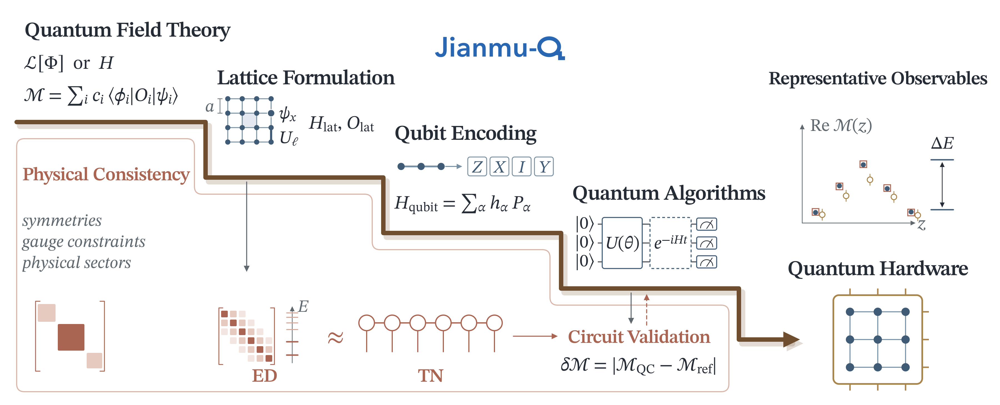

# Jianmu-Q

Jianmu-Q is a multi-agent workflow that turns natural-language descriptions of
quantum field theories into executable quantum simulations. Starting from a
model, parameters, external states and an observable, it constructs a lattice
theory, maps it to qubits, designs state preparation and measurement circuits,
generates Qiskit programs, and compares noiseless results with independent
SciPy and Julia/ITensor references. IBM Quantum validation is optional.



## Repository layout

```text
workflow/                  Reusable agents, controller and numerical runtimes
  A2_library/              Local discretization literature inputs
  A4_library/              Local circuit-design literature inputs
benchmarks/                Exactly three historical benchmark snapshots
  njl/                     1+1D NJL matrix-element subtraction
  schwinger/               1+1D Schwinger transition matrix element
  z2/                      2+1D Z2 gauge-theory energy gap
local_data/                Local experience database, generated on demand
assets/                    Project overview image
```

Manuscript sources, paper-figure scripts, legacy agent variants, local databases, regression-test sources
and other historical runs are excluded. Workflow-generated analysis figures and
academic reports remain supported by the runtime. New runs are written to
`workflow/runs/`; published benchmark snapshots live separately.

## Installation

Use Python 3.12:

```bash
git clone https://github.com/xlwang0020/Jianmu-Q.git
cd Jianmu-Q
python3.12 -m venv .venv
source .venv/bin/activate
python -m pip install -r workflow/requirements.txt
```

The ITensor reference stage also requires Julia:

```bash
julia -e 'using Pkg; Pkg.add(["ITensors", "ITensorMPS", "JSON3"])'
```

Pandoc is required for final-report conversion; XeLaTeX or pdfLaTeX enables PDF
output. These tools are unnecessary for inspecting saved benchmark JSON files.

Set `OPENAI_API_KEY` in your environment. In Bash or Zsh, hidden input can be
read with:

```bash
read -s OPENAI_API_KEY
export OPENAI_API_KEY
```

The English UI includes an **LLM provider** selector. OpenAI presets include
`gpt-6-sol` (the default for new UI inputs), `gpt-6-astra`, `gpt-6-luna`, and the
existing GPT-5.6 choices. Gemini presets include `gemini-3.8-flash` and
`gemini-3.1-pro-preview`. Both providers accept custom API model IDs; Gemini IDs
must start with `gemini-`. Saved configurations keep their selected model.
Availability depends on your API account.

For Gemini, set its own key before launching the UI:

```bash
read -s GEMINI_API_KEY
export GEMINI_API_KEY
```

All agent stages use the provider selected by the `llm` model ID. Gemini runs
use Google's OpenAI-compatible endpoint and `GEMINI_API_KEY`; OpenAI runs use
`OPENAI_API_KEY`. Optional `GEMINI_BASE_URL` and `OPENAI_BASE_URL` overrides are
provider-specific. API keys are never saved in workflow JSON. The UI checks the
selected provider's credentials, including when continuing a clarification run.

See the [official GPT-6 model documentation](https://developers.openai.com/api/docs/models/gpt-6-sol)
and [Google's compatibility documentation](https://ai.google.dev/gemini-api/docs/openai).
The historical examples retain their original model identifiers. Agent calls
consume API resources; offline validation does not.

For literature-backed generation, place readable reference `.tex` or `.txt`
files in `workflow/A2_library/` and `workflow/A4_library/`. Their README files
list the original source identifiers. Full third-party papers are not bundled.
Empty libraries are accepted, but agents must label independently derived
designs as proposals and must not invent source attribution.

## Run a new workflow

```bash
cd workflow
python -m streamlit run pipeline_ui.py
```

The UI collects scientific inputs, displays stage status, accepts physical
clarifications and supports explicit approval of reusable generated programs.

The same controller can run from the command line:

```bash
python pipeline_runtime.py run --config ../benchmarks/schwinger/config.json
```

Each benchmark includes a `config.json` for a **new generation run**, with
hardware validation disabled. The original input and execution settings are
preserved in `inputs/run_spec.json`. New LLM-generated designs and numerical
results can differ from the historical snapshots.

For a shorter run through adapter generation:

```bash
python pipeline_runtime.py run \
  --config ../benchmarks/schwinger/config.json --through agent5_observable
```

Core inputs are `model`, `parameters`, `observable`, `llm`, and either `bra`/`ket`
or a named `states` collection. A sector eigenstate specifies its quantum
numbers and zero-based `level_index`. Multiple matrix elements are combined
using the explicit coefficients in `observable.matrix_elements`. Operator
positions, ordering, transporters and sampling grids are preserved throughout
the workflow.

## Workflow and outputs

| Component | Responsibility |
|---|---|
| Agent1 | Continuous theory, physical conventions and target definitions |
| Agent2 | Discretization, boundaries, gauge treatment and parameter contract |
| Agent3 | Exact qubit/Pauli mapping and physical-sector construction |
| Agent4.1 / Agent4.2 | State-preparation / observable-measurement design |
| Agent5 | Thin model-specific Qiskit adapters |
| VQE / measurement runtimes | Deterministic optimization, noiseless scans and circuit export |
| Agent6 / Agent7 | Independent SciPy / Julia-ITensor reference programs |
| Cross-check / Agent8 | Numerical acceptance and scientific review |
| Hardware runtime / Agent9 | Optional hardware resource checks, review and execution |
| Agent10 | Evidence-based academic report |

Every new run has a `pipeline_manifest.json`, scientific `contracts/`, generated
`adapters/`, numerical `runtime/`, classical `references/`, `analysis/`,
`circuits/`, human-readable `reports/` and `audit/` records. Contracts are the
machine interfaces; prose reports are audit views.

Use the manifest printed by the controller to inspect or resume a new run:

```bash
python pipeline_runtime.py status --manifest runs/<RUN_ID>/pipeline_manifest.json
python pipeline_runtime.py resume --manifest runs/<RUN_ID>/pipeline_manifest.json --through crosscheck
python pipeline_runtime.py resume --manifest runs/<RUN_ID>/pipeline_manifest.json --through final_report
```

Human-approved program reuse skips repeated derivation and code generation for
the same physical target. It recomputes numerical results with the current
parameters; unsupported sizes or method domains fail explicitly. Approval is
available in the UI or through `pipeline_runtime.py approve-reuse --help`.

Hardware execution requires configured IBM credentials and explicit
`hardware_validation: true`. Planning alone is available through
`pipeline_runtime.py plan-hardware`. Hardware results are compared with the
identical shallow noiseless circuit, separately from convergence toward
classical references. No-evolution observables use the runtime sentinel `N_T=0`.

## Published benchmarks

| Benchmark | Source run | Observable | Hardware evidence |
|---|---|---|---|
| [NJL](benchmarks/njl/) | `20260929T024841Z_b286d0a8` | Five-site, vacuum-subtracted light-cone bilocal | Saved hardware results |
| [Schwinger](benchmarks/schwinger/) | `20260928T035738Z_5c1e78fc` | Five-site, off-diagonal light-cone matrix element | Resource screening; no submitted hardware result |
| [Z2 gauge theory](benchmarks/z2/) | `20260920T073518Z_799c77bd` | Charge-free 4×4-vertex energy gap | Shallow `ibm_kawasaki` demonstration |

These are the runs used by the final manuscript figures. All three original
deterministic cross-check verdicts are **`not_approved`**: the snapshots retain
the measured discrepancies, convergence limitations and hardware uncertainty.
They demonstrate the workflow and its diagnostics rather than universal
numerical acceptance. See [benchmark documentation](benchmarks/README.md).

## Snapshot integrity and prompts

From the repository root, verify snapshot integrity without API calls:

```bash
python benchmarks/verify.py
```

Regression tests were run before packaging; test sources are not included in
this minimal runtime distribution. Runtime experience data are created in
`local_data/simulation_knowledge.sqlite3`, outside `workflow/`, and are excluded
from Git. The database support module remains part of the execution chain.

Active prompts remain next to their agent implementations. The audit below
records resolved contradictions and historical benchmark differences.

## Runtime files

Agent 4 has two branches with separate responsibilities:

- **Agent4.1** (`agent4_1_state_preparation.py`) designs state preparation.
- **Agent4.2** (`agent4_2_observable.py`) designs observable measurement.

These are separate design steps rather than competing versions. Internal stage
IDs (`agent4_state` and `agent4_observable`) remain stable for manifests and
resume commands. Filenames use underscores so they remain valid Python module
names.

| Files | Use |
|---|---|
| `pipeline_runtime.py` | Main controller and CLI. |
| `pipeline_ui.py` | Optional Streamlit interface. |
| `agent1_formulation.py`, `agent2_Discretization.py`, `agent3_translator.py` | Theory, lattice definition and qubit mapping. |
| `agent4_1_state_preparation.py`, `agent4_2_observable.py` | Circuit-design branches. |
| `agent5_test_slim_qiskit.py` | Production adapter generator; its historical `test` filename does not make it a unit test. |
| `vqe_runtime.py`, `measurement_runtime.py` | State optimization and noiseless measurement. |
| `agent678_test_crosscheck.py`, `crosscheck_runtime.py` | Production classical-reference generation, numerical comparisons and review. |
| `hardware_runtime.py`, `Agent9_hardware.py` | Optional IBM hardware branch. |
| `agent10_final_report.py` | Final-report stage and workflow-result plots; optional when stopping at cross-check. |

The other 13 modules are imported support: `audit_report_support.py`,
`circuit_design_support.py`, `machine_contracts.py`, `manifest_artifact.py`,
`model_output_ingestion.py`, `observable_specification.py`, `parameter_contract.py`,
`pipeline_support.py`, `review_protocol.py`, `run_spec.py`, `validation_policy.py`,
`llm_support.py` (model presets and provider credentials)
and `vqe_experience_store.py`.

All 28 top-level Python modules are current entry points or their
imported dependencies. Not all execute in every run: UI, hardware and report
features are optional.

The literature directories `A2_library/` and `A4_library/` provide local text
retrieval inputs. New numerical outputs go to `workflow/runs/` and experience
data go to `local_data/`; neither is part of the public source distribution.
No preexisting database is needed. Test sources, standalone plotting tools and
manuscript scripts are excluded.

<details>
<summary>Prompt audit and historical-method compatibility</summary>

This audit covers the active agents shipped in `workflow/`, including generation,
review, correction and adapter-repair prompts. Historical scripts such as
`Agent5_COBYLA.py` and earlier agents outside AI4QCS are excluded. Prompts remain
next to their stage implementations so their schemas and executable interfaces
can be reviewed together.

## Corrections made

| Location | Conflict or ambiguity | Resolution |
|---|---|---|
| Agent2 parameter selection | One paragraph allowed null required values; another forbade them in executable contracts. | Preserve supplied physics; derive direct consequences; choose only justified stage-owned controls; stop when required physical input cannot be resolved. |
| Agent2 literature toolbox and strategy alignment | “ONLY use” the toolbox and mandatory agreement with strategic advice conflicted with physical-input precedence and applicability checks. | Literature and strategy are evidence. Reject inapplicable suggestions; derive missing constructions explicitly without invented attribution. |
| Agent2 output format | A leftover “Copy every Parameter” fragment preceded an instruction against copying parameter facts into the lattice contract. | Remove the unfinished fragment. |
| Agent3 mapping → Agent5 size reuse | Fully expanded fixed-width Pauli terms were required, while downstream adapters were asked to work at different lattice sizes. | Keep the expanded current-size list; additionally record an exact indexed mapping in the existing `circuit_definitions` list when supported. Agent5 must reproduce the current mapping and must not infer a larger Hamiltonian from fixed-size strings alone. Fixed-size implementations fail explicitly on unsupported sizes. |
| Agent4.2 finite-step symmetry | “Target sector must remain exact” could be read as projecting charge-changing insertions back into the external-state sector. | Evolution preserves conserved charges and physical constraints; ordered insertions retain every intermediate sector required upstream. |
| Agent6/7 reusable programs | “Abort only” on a changed physical target contradicted the earlier instruction to reject unsupported operations. | Also reject invalid method domains and explicitly unsupported sizes; never substitute old values. |
| Agent4.1/4.2 introductions | References to rules inherited from a “former Agent4” made the current prompts depend on absent historical context. | Use standalone stage requirement wording. |
| Agent4.1 retry policy | The search introduction duplicated detailed candidate selection and plateau-expansion rules. | Keep attempt context in the introduction; consolidate success transfer, cost comparison and expansion policy in rule 3. |

## Stage ownership

| Stage | Authoritative responsibility |
|---|---|
| Agent1 | Continuous theory, physical targets, resolved notation and physical clarifications. Explicit user formulas take precedence over conventional model names. |
| Agent2 | Finite lattice definition, boundary conditions, field treatment, truncation and compatible parameter domains. |
| Agent3 | Exact qubit mapping, Pauli conventions and physical-sector construction. |
| Agent4.1 | Unitary state-preparation design and exact requested-sector preservation. |
| Agent4.2 | Ordered observable, evolution approximation, executable measurement recipes and reconstruction. |
| Agent5 | Faithful Qiskit translation and code repair, without changing the scientific design. |
| Deterministic runtimes | Optimization, convergence policy, measurement execution, numerical comparisons and hardware resource checks. |
| Agent6/7 | Independent classical programs from the lattice definition, without quantum-result inputs. |
| Agent8/9/10 | Scientific interpretation, hardware-plan review and evidence-based reporting. |

Contracts carry scientific definitions; audit prose is not a second machine
interface. An upstream absence of a Trotter choice does not forbid Agent4.2 from
selecting a convergent approximation of the same operator. Optional hardware
results are compared with the identical shallow noiseless circuit. `N_T=0`
means no time evolution; it is not a one-step approximation.

## Redundancy retained deliberately

User-state labels, matrix-element coefficients, source precedence, and exact
sector preservation recur across stages because each call has a different
context. These repetitions are interface checks, not competing authorities.
Agent4.1's plateau and candidate-selection policy is now stated in rule 3;
the introduction supplies only the current attempt context. The remaining detailed gate, sign, symmetry
and readout rules address distinct scientific failure modes and are retained.

## Historical benchmark compatibility

The snapshots are evidence from their original runs. Their adapters, reference
programs and numerical results are preserved; edited prompts have not been used
to regenerate them. In particular, the archived Z2 run uses variational
deflation, while current sector-level designs request weighted SSVQE. The old
Z2 input writes `Gauss's law: 0` for zero charge; its actual lattice contracts
enforce the charge-free `G_v=+1` physical sector. The new example spells out that
eigenvalue. Do not silently reinterpret or modernize archived contracts.

All three stored cross-check verdicts are `not_approved`. A successful workflow
execution, a published illustration, or a hardware measurement is not evidence
that every numerical tolerance passed. Schwinger figure phase alignment is a
presentation convention and does not replace the stored raw-data verdict.

Offline regression tests were run before packaging to check executable interfaces
and controller behavior; their sources are excluded from the minimal runtime.
They do not establish that every future LLM response follows these prompts or
that a new run reproduces historical numbers.

</details>
