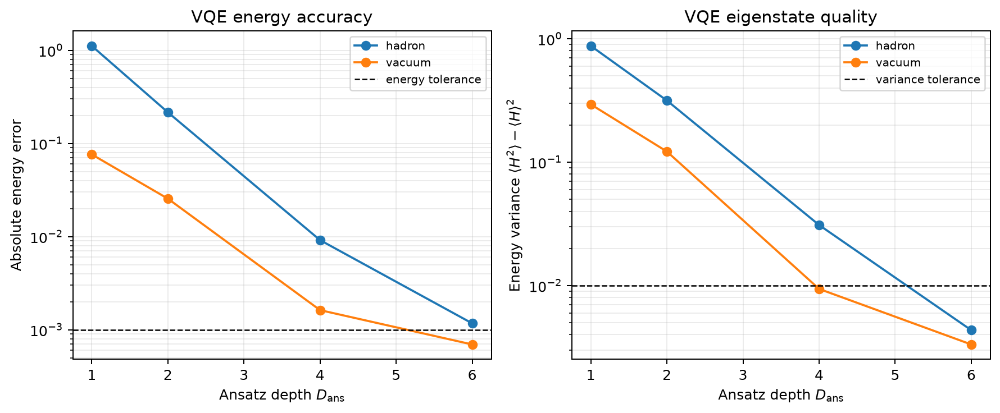
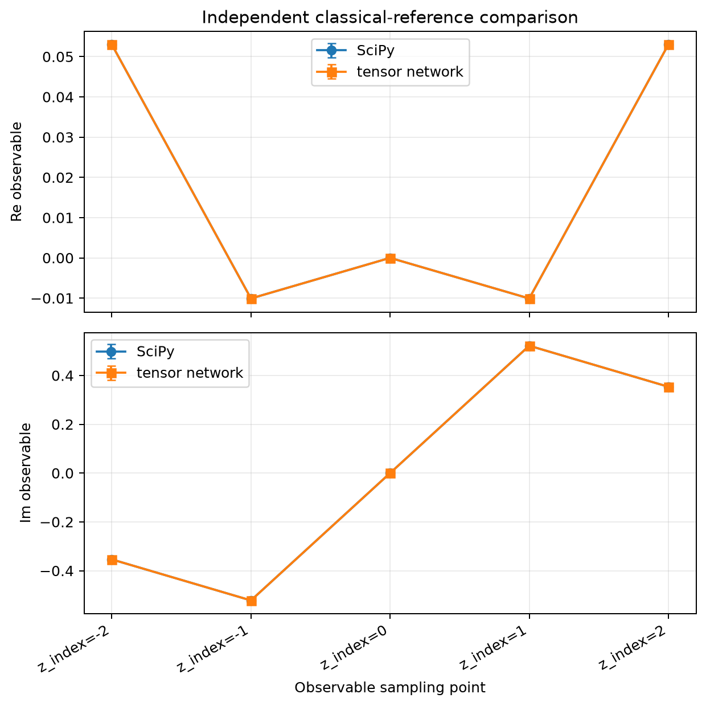
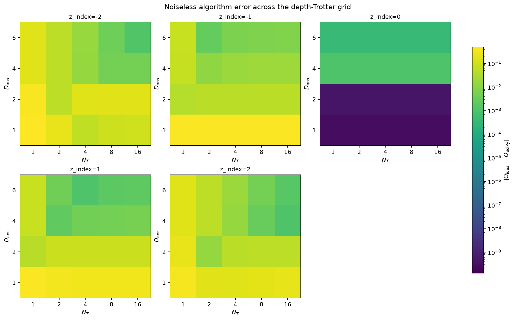
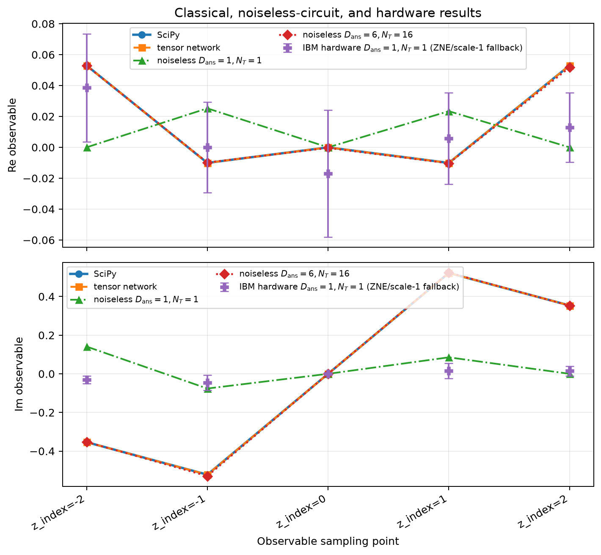
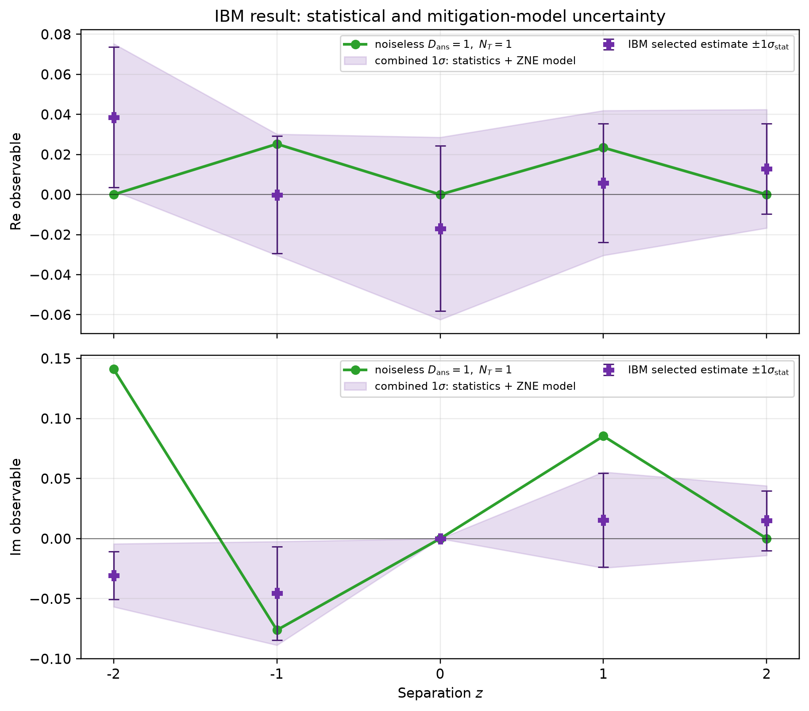

# Quantum Simulation of an Unequal-Time Bilocal Observable in the Five-Site \(1+1\)-Dimensional NJL Model

## Abstract

We report a finite-lattice quantum simulation of a vacuum-subtracted, unequal-time bilocal matrix element in the one-flavor Nambu--Jona-Lasinio (NJL) model in \(1+1\) dimensions. The continuum theory has bare mass \(m=0.5\) and four-fermion coupling \(g=0.5\). It is regulated with two-component Wilson fermions on an open chain of \(L=5\) sites at spacing \(a=1\), with no gauge fields or Gauss-law constraints. Ten fermionic modes are mapped to ten qubits by the Jordan--Wigner transformation. The requested observable is the complete combination
\[
\langle\mathrm{hadron}|O(z)|\mathrm{hadron}\rangle
-\langle\mathrm{vacuum}|O(z)|\mathrm{vacuum}\rangle
\]
at \(z\in\{-2,-1,0,1,2\}\), including both real and imaginary parts. Charge-preserving weighted subspace VQE prepares the two charge-zero states, and a same-state interferometer with second-order Suzuki evolution reconstructs the unequal-time matrix elements.

Two validation branches are kept distinct. In the noiseless branch, ansatz depths \(D_{\rm ans}=1,2,4,6\) and Trotter counts \(N_T=1,2,4,8,16\) were scanned. State preparation met its recorded criteria first at \(D_{\rm ans}=6\), but aggregate ansatz-depth and Trotter tail-stability tests failed. At \(D_{\rm ans}=6,N_T=16\), only the coincident sample met the \(10^{-3}\) algorithm tolerance against the converged SciPy reference. SciPy and tensor-network values are numerically consistent at every sample, although the tensor-network calculation failed its stringent real-time convergence test; consequently, converged two-reference validation was not established and the overall cross-check status was not approved. In the separate minimal-hardware branch, the deliberately shallow \(D_{\rm ans}=1,N_T=1\) circuits were executed on `ibm_kawasaki`. These hardware data test only reproduction of the identical shallow noiseless circuits and do not validate the deeper algorithm, the classical answer, or a continuum limit. Error mitigation combined measurement mitigation with attempted zero-noise extrapolation (ZNE), but several component observables reverted to scale-1 estimates because extrapolated uncertainties failed the stability rule.

## 1. Physical problem and continuum formulation

### 1.1 Continuum theory and conventions

The one-flavor NJL model is defined by
$$
\mathcal L
=
\bar\psi\left(i\gamma^\mu\partial_\mu-m\right)\psi
+g(\bar\psi\psi)^2,
$$
with \(m=0.5\) and \(g=0.5\). Natural units with \(c=1\) are used. The metric is
\[
\eta_{\mu\nu}=\operatorname{diag}(1,-1),
\qquad
\{\gamma^\mu,\gamma^\nu\}=2\eta^{\mu\nu}.
\]
The continuum Hamiltonian is
$$
H=\int dx\,
\left[
\psi^\dagger\left(-i\alpha^1\partial_x+\beta m\right)\psi
-g(\bar\psi\psi)^2
\right],
\qquad
\alpha^1=\gamma^0\gamma^1,\quad \beta=\gamma^0.
$$
No additive vacuum-energy shift is made. Vacuum subtraction occurs only in the requested matrix-element combination below.

A convenient representation, also used in the lattice realization, is
\[
\gamma^0=\sigma_1,\qquad
\gamma^1=-i\sigma_2,\qquad
\gamma^5=\gamma^0\gamma^1=\sigma_3.
\]
The light-cone convention has unit normalization:
\[
x^\pm=x^0\pm x^1,\qquad
\gamma^\pm=\gamma^0\pm\gamma^1,
\qquad
\gamma^-=\gamma^0-\gamma^1.
\]
The theory has no local gauge group. Its exact internal continuous symmetry is the global vector \(U(1)\), with conserved charge
$$
Q=\int dx\,\bar\psi\gamma^0\psi
=\int dx\,\psi^\dagger\psi.
$$

### 1.2 External states and requested observable

The external states are defined within the charge-zero sector:

- \(|\mathrm{vacuum}\rangle\) is the zero-based level \(0\) eigenstate of the charge-zero Hamiltonian block.
- \(|\mathrm{hadron}\rangle\) is the distinct zero-based level \(1\) eigenstate of the same block.

The ordered bilocal operator is
$$
O(z)=
\bar\psi(za,za)(\gamma^0-\gamma^1)\psi(0,0),
\qquad
z\in\{-2,-1,0,1,2\},
$$
where the physical-coordinate assignment is
\[
(t,x)=(za,za),\qquad a=1.
\]
The order of insertions is exactly as written. The complete requested observable is the linear combination
$$
\mathcal M(z)
=
1\cdot\langle\mathrm{hadron}|O(z)|\mathrm{hadron}\rangle
-1\cdot\langle\mathrm{vacuum}|O(z)|\mathrm{vacuum}\rangle.
$$
Both \(\operatorname{Re}\mathcal M(z)\) and \(\operatorname{Im}\mathcal M(z)\) are requested. Neither component matrix element alone is the target observable.

Although combined \(PT\) maps the sampling grid into sign-reversed pairs, no \(C\), \(P\), \(T\), or \(PT\) eigenvalues were specified for either external state. No complex phase rotation or real/imaginary parity relation is therefore imposed or inferred from the symmetric grid. In particular, an overall state phase cancels in each diagonal matrix element and cannot be used to align the observable.

## 2. Lattice discretization and boundary conditions

### 2.1 Wilson-fermion Hamiltonian

The spatial lattice contains the five sites
\[
x\in\{-2,-1,0,1,2\},
\]
with spacing \(a=1\), open boundary conditions, continuous Hamiltonian time, and Wilson parameter \(r=1\). Each site carries a two-component canonical fermion \(c_x\). The complete finite-lattice Hamiltonian is
$$
\begin{aligned}
H_{\rm lat}
={}&
\sum_{x=-2}^{2}
c_x^\dagger\beta\left(m+\frac{r}{a}\right)c_x\\
&+\sum_{x=-2}^{1}
\left[
c_x^\dagger
\left(-\frac{i\alpha^1}{2a}-\frac{r\beta}{2a}\right)c_{x+1}
+
c_{x+1}^\dagger
\left(\frac{i\alpha^1}{2a}-\frac{r\beta}{2a}\right)c_x
\right]\\
&-\frac{g}{a}\sum_{x=-2}^{2}
\left(c_x^\dagger\beta c_x\right)^2,
\end{aligned}
$$
with
\[
\beta=\sigma_1,\qquad \alpha^1=\sigma_3,\qquad
m=g=0.5,\qquad a=r=1.
\]
The full onsite Wilson coefficient \(r/a\) is retained even at the endpoints; it is not reduced according to endpoint coordination. No additive energy shift is introduced.

The centered derivative and Wilson second difference couple only the four retained nearest-neighbor links. Open boundaries break one-site translation symmetry, and no exact Lorentz-boost generator exists at finite \(a\) and finite \(L\). The Wilson regulator retains both Dirac components, so there are ten canonical fermion modes. Their occupations \(0\) and \(1\) are exact rather than an approximate local truncation. The full Fock-space dimension is \(2^{10}=1024\).

The lattice charge is
$$
Q_{\rm lat}
=
\sum_{x=-2}^{2}\sum_{s=1}^{2}
c_{x,s}^\dagger c_{x,s}-5,
$$
and satisfies \([H_{\rm lat},Q_{\rm lat}]=0\). The charge-zero sector has dimension \(\binom{10}{5}=252\), while the intermediate charge-minus-one sector has dimension \(\binom{10}{4}=210\).

### 2.2 Lattice observable

Because
\[
\beta\gamma^-=\mathbf 1-\alpha^1=\mathbf 1-\sigma_3,
\]
the lattice bilocal is
$$
O_{\rm lat}(z)
=
\frac{1}{a}\,
c_z^\dagger(za)(\mathbf 1-\sigma_3)c_0,
\qquad
c_x^\dagger(t)=
e^{iH_{\rm lat}t}c_x^\dagger e^{-iH_{\rm lat}t}.
$$
The ordered operator path is
$$
Q_{\rm lat}=0
\xrightarrow{\,c_0\,}
Q_{\rm lat}=-1
\xrightarrow{\,e^{-iH_{\rm lat}t}\,}
Q_{\rm lat}=-1
\xrightarrow{\,c_z^\dagger\,}
Q_{\rm lat}=0.
$$
Thus both charge sectors must be represented even though the external states have charge zero.

At \(z=0\), the coincident composite is represented directly by the finite operator
\[
O_{\rm lat}(0)
=
a^{-1}c_0^\dagger(\mathbf 1-\sigma_3)c_0.
\]
Likewise, the interaction uses the direct finite operator \((c_x^\dagger\beta c_x)^2\). No point-splitting or continuum renormalization prescription beyond this finite regulator is claimed.

### 2.3 Absence of gauge-field truncation

This is a matter-only model with a global \(U(1)\), not a gauge theory. Consequently:

- there are no link variables or gauge qubits;
- no gauge-field truncation is performed;
- no Gauss-law constraint or gauge fixing is introduced;
- no gauge transporter appears in the bilocal operator.

Gauss-law elimination is therefore not applicable.

## 3. Qubit mapping and physical sectors

Modes are ordered by
\[
j=2(x+2)+(s-1),
\]
so that
\[
(q_0,q_1,\ldots,q_9)
=
((-2,1),(-2,2),\ldots,(2,1),(2,2)).
\]
The Jordan--Wigner mapping is
$$
c_j=
\left(\prod_{k=0}^{j-1}Z_k\right)
\frac{X_j+iY_j}{2},
\qquad
c_j^\dagger=
\left(\prod_{k=0}^{j-1}Z_k\right)
\frac{X_j-iY_j}{2},
\qquad
n_j=\frac{\mathbf 1-Z_j}{2}.
$$
Pauli strings use Qiskit little-endian label order. The mapped Hamiltonian \(H_{\rm qc}\) is the exact ten-qubit Pauli sum obtained from \(H_{\rm lat}\), including its identity contribution; it is not vacuum shifted.

The mapped charge and parity are
$$
Q_{\rm qc}=-\frac12\sum_{j=0}^{9}Z_j,
\qquad
(-1)^F=Z_0Z_1\cdots Z_9,
$$
with
\[
[H_{\rm qc},Q_{\rm qc}]=0,
\qquad
[H_{\rm qc},Z_0Z_1\cdots Z_9]=0.
\]
The external states occupy the popcount-five subspace, where \(Q_{\rm qc}=0\) and fermion parity is \(-1\). The intermediate state after the rightmost annihilation occupies the popcount-four subspace, where \(Q_{\rm qc}=-1\). Exact restricted Hamiltonian blocks have dimensions \(252\) and \(210\), respectively.

The mapped coincident operator is
\[
O_{\rm qc}(0)=\mathbf 1-Z_5=2n_5.
\]
Identity contributions cancel between the hadron and vacuum coefficients in the requested subtraction.

## 4. Quantum algorithm

### 4.1 Symmetry-preserving state preparation

Both states begin from \(|n_9\cdots n_0\rangle=|1010101010\rangle\). Local \(H\)- and controlled-NOT gates create one-fermion two-mode states on each site pair. The vacuum reference uses
\[
\frac{|01\rangle-|10\rangle}{\sqrt2}
\]
on all five pairs. The hadron reference replaces the central pair by
\[
\frac{|01\rangle+|10\rangle}{\sqrt2}.
\]
The references are orthogonal and have five occupied modes.

The same shared variational unitary is applied to both references. Each depth layer contains, in order:

1. \(R_Z(\alpha_{d,j})\) on \(q_j\), \(j=0,\ldots,8\);
2. \(R_{ZZ}(\beta_{d,j})\) on each edge \((q_j,q_{j+1})\);
3. shared-angle \(R_{XX}(\gamma_{d,j})R_{YY}(\gamma_{d,j})\) exchange blocks on the same edges.

Each layer therefore has \(27\) independent parameters. New depths append complete layers with fresh parameters without changing earlier layers. Diagonal rotations conserve occupation, while the shared \(XX+YY\) exchange commutes with \(Z_j+Z_{j+1}\); every complete layer preserves the charge-zero sector and odd fermion parity exactly.

A weighted subspace VQE uses weights \(2/3\) for the vacuum and \(1/3\) for the hadron, with orthogonal references evolved by the same unitary. The tested state-preparation depths were \(D_{\rm ans}=1,2,4,6\). The runtime policy allowed nested continuation and deeper scheduled extensions, but the recorded state-preparation threshold was first reached at \(D_{\rm ans}=6\); no hardware claim is made for that deeper circuit.

### 4.2 Real-time evolution and Trotterization

For \(z\neq0\), evolution over \(t=za\) uses a charge-preserving, even--odd grouped, second-order Suzuki product formula. One step applies:

1. half-step exponentials of all onsite blocks;
2. half-step exponentials of even links \(l=0,2\);
3. full-step exponentials of odd links \(l=1,3\);
4. half-step exponentials of even links;
5. half-step exponentials of onsite blocks.

Each two- or four-qubit local exponential is constructed exactly as a fixed-width matrix and synthesized into \(R_Z\), \(R_Y\), and controlled-NOT gates. Every local block commutes with \(Q_{\rm qc}\), so finite-\(N_T\) evolution exactly preserves the charge sectors and fermion parity. Finite product-formula ordering need not preserve reflection or antiunitary lattice symmetries. The tested Trotter counts were
\[
N_T=1,2,4,8,16.
\]
At \(z=0\), no evolution is needed and the direct coincident operator is measured.

### 4.3 Interferometric measurement and reconstruction

For \(z\neq0\), an additional ancilla implements a same-state interferometer. After state preparation, the ancilla is placed in superposition, controls the right endpoint Pauli string, and is followed by uncontrolled product-formula time evolution and a controlled left endpoint string. Measuring ancilla \(Z\) after an \(H\) or \(S^\dagger H\) basis change gives the real or imaginary interferometric component.

For state \(s\in\{h,v\}\), denoting hadron by \(h\) and vacuum by \(v\), let \(R_{s,k}\) and \(I_{s,k}\) be the measured real- and imaginary-channel expectations for trajectory \(k=0,1,2,3\). Define
\[
s_h=+1,\qquad s_v=-1.
\]
The complete vacuum-subtracted observable is reconstructed as
$$
\operatorname{Re}\mathcal M(z)
=
\frac12\sum_{s\in\{h,v\}}s_s
\left(
R_{s,0}-I_{s,1}+I_{s,2}+R_{s,3}
\right),
$$
$$
\operatorname{Im}\mathcal M(z)
=
\frac12\sum_{s\in\{h,v\}}s_s
\left(
I_{s,0}+R_{s,1}-R_{s,2}+I_{s,3}
\right).
$$
At \(z=0\),
$$
\operatorname{Re}\mathcal M(0)
=
\langle Z_5\rangle_{\rm vacuum}
-\langle Z_5\rangle_{\rm hadron},
\qquad
\operatorname{Im}\mathcal M(0)=0.
$$
These formulas retain every coefficient and sign in the measured linear combination.

## 5. Numerical results

### 5.1 Classical finite-lattice references

SciPy exact diagonalization converged with zero recorded charge-commutator and Hermiticity errors, a maximum eigenstate residual norm of \(2.19\times10^{-14}\), and ground-state variance \(4.78\times10^{-28}\). The unshifted energies were
\[
E_{\rm vacuum}=-10.508405668356518,
\qquad
E_{\rm hadron}=-8.506186650041041.
\]

The tensor-network calculation used DMRG scans up to bond dimension \(160\), followed by compressed-MPS Taylor evolution with maximum bond dimension \(256\). Its ground-state energy was \(-10.508405668345588\), differing from SciPy by \(1.09\times10^{-11}\). Its maximum energy variance was \(1.24\times10^{-10}\). However, the maximum change under time-step refinement was \(1.602\times10^{-3}\), above the prescribed \(10^{-6}\) observable-time-scan tolerance, so the tensor-network reference was not declared converged.

| \(z\) | SciPy \(\operatorname{Re}\mathcal M\) | SciPy \(\operatorname{Im}\mathcal M\) | Tensor network \(\operatorname{Re}\mathcal M\) | Tensor network \(\operatorname{Im}\mathcal M\) |
|---:|---:|---:|---:|---:|
| \(-2\) | \(0.0530031\) | \(-0.353737\) | \(0.0530085\) | \(-0.353751\) |
| \(-1\) | \(-0.0100856\) | \(-0.521787\) | \(-0.0100894\) | \(-0.521803\) |
| \(0\) | \(4.4\times10^{-16}\) | \(2.5\times10^{-39}\) | \(-1.3\times10^{-15}\) | \(2.9\times10^{-17}\) |
| \(1\) | \(-0.0100856\) | \(0.521787\) | \(-0.0100880\) | \(0.521801\) |
| \(2\) | \(0.0530031\) | \(0.353737\) | \(0.0530055\) | \(0.353754\) |

The largest SciPy--tensor-network observable difference was \(1.70\times10^{-5}\), below the classical tolerance \(10^{-4}\) and below the corresponding combined uncertainty. Thus the two references are numerically consistent at all five samples. Nevertheless, the aggregate classical cross-check failed because only SciPy satisfied its convergence test. Numerical agreement must not be conflated with converged two-method validation.

### 5.2 Branch A: noiseless algorithm validation

#### VQE quality

At the shallow hardware depth \(D_{\rm ans}=1\), both states were only best-effort approximations:

| State | Energy | Absolute energy error | Variance |
|:--|--:|--:|--:|
| Vacuum, \(D_{\rm ans}=1\) | \(-10.4322\) | \(7.62\times10^{-2}\) | \(2.94\times10^{-1}\) |
| Hadron, \(D_{\rm ans}=1\) | \(-7.39234\) | \(1.11\) | \(8.76\times10^{-1}\) |
| Vacuum, \(D_{\rm ans}=6\) | \(-10.5077\) | \(6.95\times10^{-4}\) | \(3.33\times10^{-3}\) |
| Hadron, \(D_{\rm ans}=6\) | \(-8.50502\) | \(1.17\times10^{-3}\) | \(4.35\times10^{-3}\) |

At \(D_{\rm ans}=6\), sector weights remained unity to numerical precision and the inter-state overlap was \(5.72\times10^{-32}\). Both states were marked as converged by the recorded VQE state criteria, despite the optimizer terminating at its iteration limit. The state-preparation validation therefore concerns energies, variances, sectors, and orthogonality; it does not by itself guarantee convergence of the unequal-time observable.

#### Depth and Trotter scans

The noiseless observable scan used
\[
D_{\rm ans}\in\{1,2,4,6\},
\qquad
N_T\in\{1,2,4,8,16\}.
\]
A tail tolerance of \(10^{-3}\) was used for both scans. The ansatz-depth aggregate test failed: \(19\) of \(25\) fixed-\(N_T\) series had final depth increments above tolerance. The Trotter aggregate test also failed: \(8\) of \(20\) fixed-depth series remained above tolerance, specifically all series at \(z=-2\) and \(z=2\). Series at \(z=-1,0,1\) passed the Trotter tail test. Point-by-point monotonic convergence was neither required nor observed.

At the deepest recorded endpoint \(D_{\rm ans}=6,N_T=16\), comparison with SciPy gave:

| \(z\) | Noiseless \(\operatorname{Re}\mathcal M\) | Noiseless \(\operatorname{Im}\mathcal M\) | Error versus SciPy | Within \(10^{-3}\)? |
|---:|---:|---:|---:|:--:|
| \(-2\) | \(0.0528173\) | \(-0.352550\) | \(1.20\times10^{-3}\) | No |
| \(-1\) | \(-0.00981118\) | \(-0.529114\) | \(7.33\times10^{-3}\) | No |
| \(0\) | \(-3.94825\times10^{-4}\) | \(0\) | \(3.95\times10^{-4}\) | Yes |
| \(1\) | \(-0.0103192\) | \(0.523820\) | \(2.05\times10^{-3}\) | No |
| \(2\) | \(0.0517117\) | \(0.352875\) | \(1.55\times10^{-3}\) | No |

Therefore, observed improvement toward the classical reference is substantial, but convergence over the full observable grid is not established. No extrapolation to \(D_{\rm ans}\to\infty\) or \(N_T\to\infty\) was performed. The deterministic cross-check verdict was **not approved** because the tensor-network convergence test, aggregate depth convergence, aggregate Trotter convergence, and four of five final endpoint checks failed.

This branch validates the implementation of sector-preserving state preparation, observable reconstruction, and the trend toward finite-lattice classical results. It does not establish full algorithmic convergence.

### 5.3 Branch B: minimal-hardware demonstration point

The hardware branch deliberately fixed
\[
D_{\rm ans}=1,\qquad N_T=1,
\]
including at \(z=0\), where evolution is absent even though the runtime label retains \(N_T=1\). These are unvalidated best-effort states and are not part of the deeper convergence claim. Their noiseless reconstructed values are:

| \(z\) | Shallow noiseless \(\operatorname{Re}\mathcal M\) | Shallow noiseless \(\operatorname{Im}\mathcal M\) | Error versus SciPy |
|---:|---:|---:|---:|
| \(-2\) | \(4.4\times10^{-10}\) | \(0.141046\) | \(0.498\) |
| \(-1\) | \(0.0252412\) | \(-0.0761081\) | \(0.447\) |
| \(0\) | \(2.60\times10^{-10}\) | \(0\) | \(2.60\times10^{-10}\) |
| \(1\) | \(0.0234061\) | \(0.0853476\) | \(0.438\) |
| \(2\) | \(3.15\times10^{-13}\) | \(8.42\times10^{-5}\) | \(0.358\) |

Except for an accidental near-zero agreement at \(z=0\), these shallow circuits have large algorithmic errors relative to SciPy. The hardware demonstration must consequently be judged only against these identical shallow noiseless values, not against SciPy, the tensor-network data, or the \(D_{\rm ans}=6\) circuits.

## 6. Quantum-hardware demonstration

### 6.1 Execution and resources

All five shallow samples were retrieved from the 156-qubit `ibm_kawasaki` backend. The noncoincident interferometers used ten system qubits plus one ancilla. Before hardware transpilation, typical component recipes had logical depths \(645\)--\(654\) and approximately \(667\)--\(675\) two-qubit gates. The direct \(z=0\) recipes used ten qubits, logical depth \(100\), and \(59\) two-qubit gates.

The hardware resource gate passed. After backend compilation, the four noncoincident sample deployments had maximum recipe depths around \(2033\)--\(2077\) and approximately \(14.4\times10^3\) two-qubit gates across all recipes in each deployment. Their maximum per-recipe calibrated two-qubit error sums, \(0.978\)--\(0.994\), were close to the configured limit \(1.0\). The \(z=0\) deployment was much smaller, with depth \(101\) and \(78\) total two-qubit gates. No missing two-qubit calibration errors or inserted SWAPs were recorded. Passing this deterministic resource gate did not make the circuits algorithmically eligible: the cross-check recorded no hardware-eligible candidates because the \(D_{\rm ans}=1\) state preparation was unvalidated.

### 6.2 Hardware values and same-circuit comparison

The reconstructed hardware results, with one-standard-error statistical uncertainties, are:

| \(z\) | Hardware \(\operatorname{Re}\mathcal M\) | Hardware \(\operatorname{Im}\mathcal M\) | Identical noiseless \(\operatorname{Re}\mathcal M\) | Identical noiseless \(\operatorname{Im}\mathcal M\) |
|---:|---:|---:|---:|---:|
| \(-2\) | \(0.0386\pm0.0350\) | \(-0.0305\pm0.0199\) | \(0.0000\) | \(0.1410\) |
| \(-1\) | \(-0.0001\pm0.0293\) | \(-0.0455\pm0.0389\) | \(0.0252\) | \(-0.0761\) |
| \(0\) | \(-0.0169\pm0.0412\) | \(0\) | \(0.0000\) | \(0\) |
| \(1\) | \(0.0058\pm0.0296\) | \(0.0155\pm0.0391\) | \(0.0234\) | \(0.0853\) |
| \(2\) | \(0.0129\pm0.0226\) | \(0.0150\pm0.0249\) | \(0.0000\) | \(0.0001\) |

The largest conspicuous same-circuit discrepancy is the imaginary component at \(z=-2\), where the hardware value differs from the shallow noiseless value by \(-0.172\), much larger than its \(0.0199\) standard error. Other components have larger relative uncertainties and generally smaller standardized discrepancies. These observations characterize this specific shallow circuit only.

The figure overlays all branches for context. The hardware points must not be interpreted as samples from the deeper noiseless convergence scan: only \(D_{\rm ans}=1,N_T=1\) was executed on hardware. Similarly, proximity of a hardware point to a classical value would not demonstrate classical or continuum accuracy because the hardware target is the identical shallow noiseless circuit.

### 6.3 Error mitigation and uncertainties

The backend run used resilience level \(2\), measurement mitigation, and attempted ZNE with noise factors
\[
\lambda\in\{1,3,5\},
\]
using exponential or linear extrapolation. ZNE was applied at the component-recipe level before reconstructing the full observable.

Several component fits were accepted as `zne_extrapolated`. Others were marked `noise_factor_1_fallback_unstable_zne`. The latter are not ZNE results: the extrapolated uncertainty failed the stability rule, so the scale-1 mitigated estimate was used as a fallback. The final reconstructed points can therefore mix accepted extrapolations and scale-1 fallback components. Reported error bars propagate the available component statistical errors, but they do not encompass shallow-state preparation error, finite-\(N_T\) error, calibration drift, or an uncertainty for continuum extrapolation.

A retrospective uncertainty decomposition was performed from the saved noise-factor \(1,3,5\) data. In the figure below, the narrow error bars retain the original statistical standard errors of the selected recipe estimates. The light band additionally propagates the recipe-level spread among all valid exponential, linear, and lowest-noise fallback estimates, combined in quadrature with the statistical variance. The resulting combined one-standard-deviation scales for \((\operatorname{Re}\mathcal M,\operatorname{Im}\mathcal M)\) are \((0.0368,0.0262)\), \((0.0303,0.0431)\), \((0.0455,0)\), \((0.0362,0.0400)\), and \((0.0296,0.0290)\) for \(z=-2,-1,0,1,2\), respectively.

The additional band quantifies sensitivity to the available mitigation-model choice, but it remains incomplete. In particular, it does not include calibration or temporal drift, correlations between recipes, or residual depth-dependent signal attenuation. The last omission is especially important for the noncoincident circuits, whose compiled depths exceed \(2000\): the hardware can measure a statistically precise but systematically attenuated value. The band was not enlarged using the noiseless target and is therefore neither designed nor guaranteed to cover it.

This hardware branch validates only that the selected shallow measurement and reconstruction workflow was executed and provides an empirical comparison with its identical noiseless circuit. It does not validate deeper state preparation, Trotter convergence, the finite-lattice classical answer, or continuum physics.

## 7. Limitations

Several limitations prevent a stronger physics conclusion.

1. **Finite regulator and volume.** Only \(a=1\), \(L=5\), and open boundaries were studied. There is no lattice-spacing or volume scan and hence no continuum- or infinite-volume extrapolation.
2. **Incomplete tensor-network convergence.** Tensor-network energies and observable values are numerically consistent with SciPy, but the real-time refinement criterion was not met.
3. **Incomplete noiseless convergence.** The ansatz-depth and Trotter scans both failed their aggregate \(10^{-3}\) tail-stability tests. Four of five deepest endpoints remained outside the \(10^{-3}\) algorithm tolerance.
4. **Shallow hardware state quality.** The hardware circuits used \(D_{\rm ans}=1\), where the hadron and vacuum had substantial energy errors and variances. Their hardware execution cannot test the accuracy of the validated \(D_{\rm ans}=6\) states.
5. **Hardware noise and mixed mitigation.** Four noncoincident deployments were deep and had per-recipe error sums near the resource limit. Some component estimates used scale-1 fallback rather than successful ZNE.
6. **No symmetry-based phase reduction.** External-state discrete-symmetry quantum numbers were unspecified. The apparent sign patterns in the classical grid are reported as numerical results, not imposed symmetry constraints.
7. **Regulated composite operator.** The coincident operator and four-fermion interaction are well-defined on the finite Wilson lattice, but no separate renormalization or matching to a continuum composite operator was supplied.

## 8. Conclusion

A complete finite-lattice realization of the requested vacuum-subtracted bilocal NJL observable was constructed using two-component Wilson fermions, ten-qubit Jordan--Wigner encoding, charge-preserving subspace VQE, second-order product-formula time evolution, and ancilla interferometry. Exact SciPy diagonalization supplies a converged finite-lattice reference. Tensor-network results agree numerically with it but do not satisfy the prescribed real-time convergence criterion.

The noiseless quantum algorithm improves strongly with ansatz depth and Trotter refinement, and state preparation is validated at \(D_{\rm ans}=6\). Nevertheless, the full unequal-time observable is not converged under the recorded tolerances: only the coincident point passes at \(D_{\rm ans}=6,N_T=16\). The deterministic cross-check is therefore not approved.

A separate \(D_{\rm ans}=1,N_T=1\) demonstration was executed on IBM hardware with measurement mitigation and mixed ZNE/fallback processing. Its scientifically appropriate benchmark is only the identical shallow noiseless circuit. It neither demonstrates agreement with the finite-lattice classical solution nor supplies evidence for continuum-limit accuracy.

## 9. References and evidence provenance

Only literature records explicitly supplied with the computational evidence are listed. Author and title metadata were not provided and are therefore not inferred.

1. arXiv:2606.22602v1, section “Preparation of hadronic state,” reference-state equation labelled `refst`. Used in modified form only for the local two-mode singlet reference motif; its periodic gauge-theory dynamics, momentum projection, and long-range ansatz were not used.
2. arXiv:2401.08044v2, sections “Hadron Wavepacket Preparation” and “Real-time Simulations using IBM's Digital Quantum Computers.” The localized neutral-pair concept and finite product-formula context were relevant, but the staggered gauge Hamiltonian, adiabatic wavepacket circuit, and forward--backward mitigation protocol were not used as the unequal-time measurement circuit.
3. arXiv:2308.04481v3, section “Building Scalable State Preparation Quantum Circuits using SC-ADAPT-VQE with Classical Computing,” including the cited convergence table and discussion. It supports symmetry-preserving local state-preparation circuits in general; its staggered gauge discretization and operator sequence were not adopted.

The numerical evidence comprises a SciPy exact-diagonalization reference, an ITensor matrix-product-state reference, noiseless circuit scans over \(D_{\rm ans}\) and \(N_T\), and retrieved `ibm_kawasaki` hardware results. The authoritative run identifier is `20260929T024841Z_b286d0a8`.
