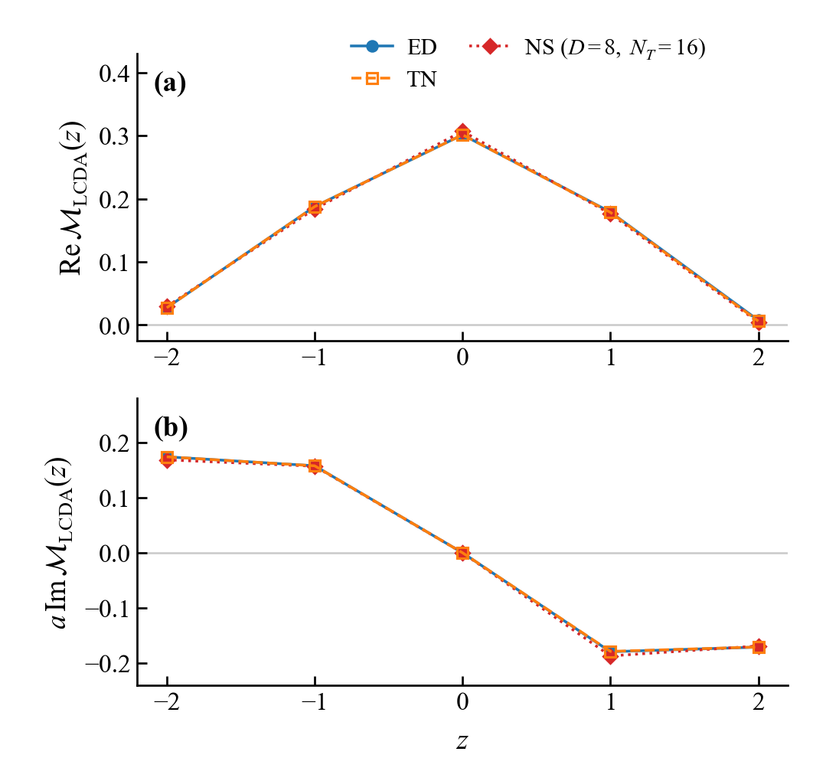

# Schwinger benchmark

Source run: `20260928T035738Z_5c1e78fc`. Selected from the final revised manuscript figure sources.

- [Final report (PDF)](reports/Final_Academic_Report_20260928T035738Z_5c1e78fc.pdf)
- [Final report (Markdown)](reports/Final_Academic_Report_20260928T035738Z_5c1e78fc.md)
- [Original report result images](reports/figures/)
- [Final manuscript figures and data](figures/paper/)

The stored cross-check verdict is `not_approved`; images and hardware results do not override it. Generated programs and numerical results retain the original run versions. `config.json` starts a new workflow with current prompts and hardware disabled.
