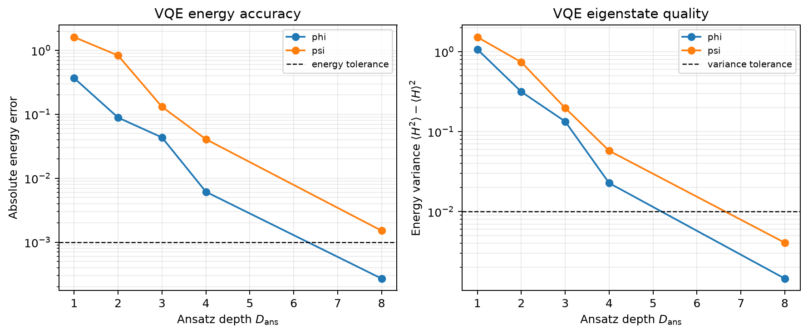
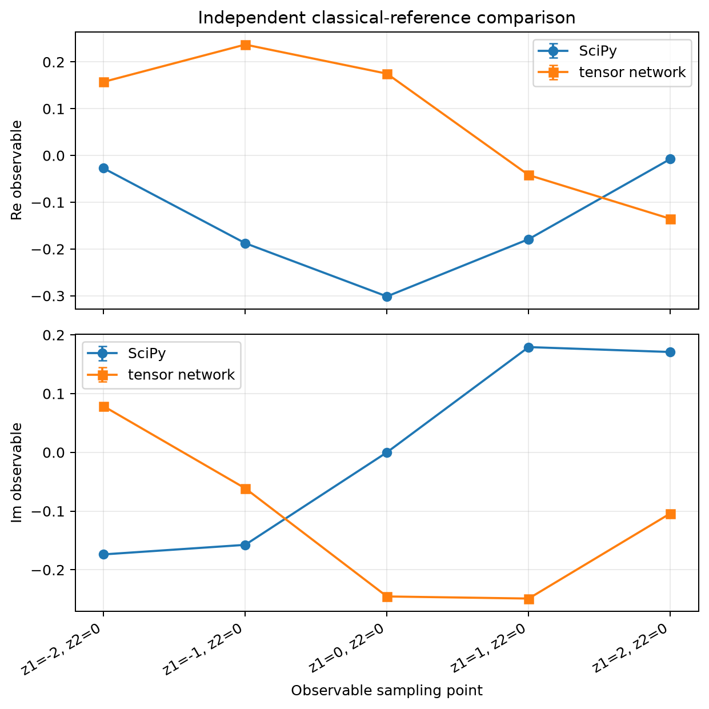
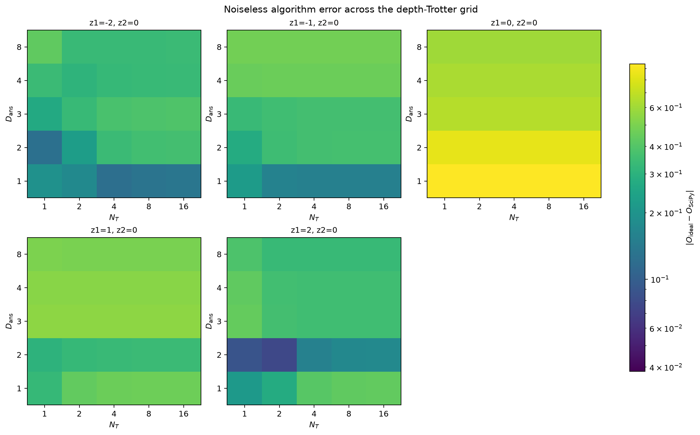
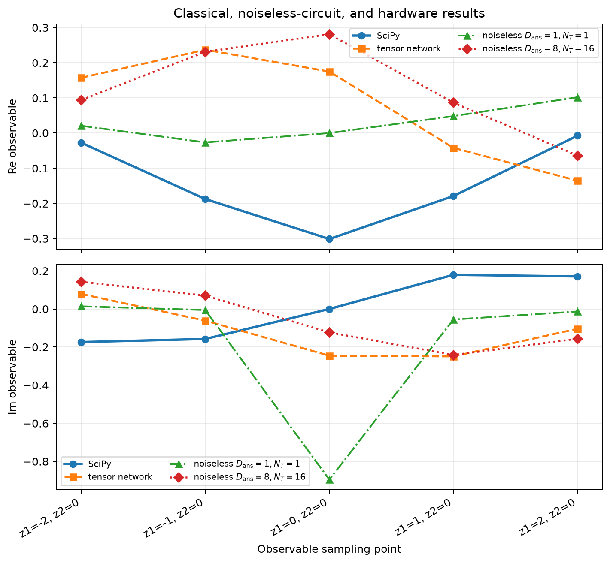
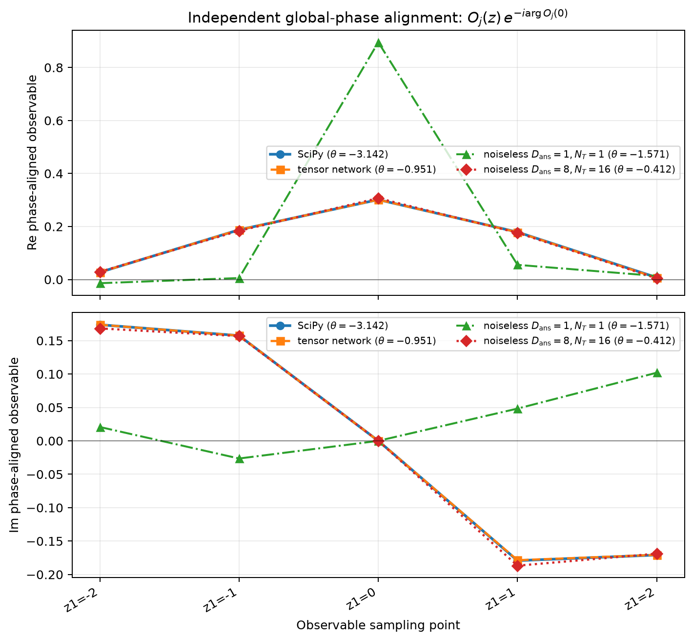

# Gauge-Invariant Lightlike Transition Matrix Elements in a Five-Site Wilson-Fermion Schwinger Model: Noiseless Validation and Hardware-Feasibility Assessment

## Abstract

A quantum-computing formulation is presented for a gauge-invariant bilocal transition matrix element in the one-flavour massive Schwinger model in $1+1$ dimensions. The continuum theory has bare coupling $g=0.5$ and fermion mass $m=0.5$ in natural units. It is discretized on five open spatial sites with spacing $a=1$ and equal temporal spacing, using two-component Wilson fermions with Wilson parameter $r=1$. Spatial axial gauge and exact Gauss-law elimination remove all independent gauge-link variables without an electric-flux truncation. The resulting ten fermionic modes are mapped exactly to ten qubits by the Jordan--Wigner transformation; one additional ancilla is used for transition-amplitude interferometry. The external states are the two lowest distinct eigenstates in the neutral sector. A shared, number-conserving subspace-search variational ansatz is tested at depths $D_{\rm ans}=1,2,3,4,8$, while real-time evolution is approximated by a symmetric second-order product formula with $N_T=1,2,4,8,16$ steps.

State energies and variances improve substantially with ansatz depth, and the depth-eight states satisfy the recorded state-preparation criteria. Nevertheless, under the raw independently chosen external-state phase conventions, all 125 noiseless circuit points fail the algorithm tolerance of $10^{-3}$, depth convergence fails globally, and Trotter convergence is incomplete. The tensor-network reference reproduces the low-lying energies to approximately $5\times10^{-12}$ but is explicitly nonconverged for the observable. Its large raw complex-plane difference from SciPy is predominantly an external-state phase-convention difference: after independently fixing each result family to be real and positive at $z_1=0$, their maximum discrepancy is $1.39\times10^{-3}$. The corresponding deepest noiseless discrepancy is $8.06\times10^{-3}$, whereas the shallow discrepancy remains $0.594$. Because the registered cross-check used the raw convention and the aligned deep result still exceeds $10^{-3}$, the overall deterministic cross-check remains not approved. The prescribed minimal-hardware branch uses only $D_{\rm ans}=1$ and $N_T=1$ and is scientifically comparable only to the identical noiseless circuit. No IBM job was submitted because every candidate failed the hardware resource gate; consequently, no hardware measurements, statistical hardware error bars, or zero-noise extrapolation results are available.

## 1. Physical Problem and Continuum Formulation

### 1.1 Continuum theory and conventions

The continuum model is the one-flavour massive U(1) Schwinger model with Lagrangian

$$
\mathcal L
=
-\frac14F_{\mu\nu}F^{\mu\nu}
+
\bar\psi\left(i\gamma^\mu D_\mu-m\right)\psi,
\qquad
D_\mu=\partial_\mu+igA_\mu,
$$

where

$$
F_{\mu\nu}=\partial_\mu A_\nu-\partial_\nu A_\mu.
$$

The metric is $\eta_{\mu\nu}=\operatorname{diag}(1,-1)$, the electric field is $E=F_{01}=F^{10}$, and natural units with $c=1$ are used. The fixed gamma-matrix representation is

$$
\gamma^0=\sigma_1,\qquad
\gamma^1=-i\sigma_2,\qquad
\gamma^5=\gamma^0\gamma^1=\sigma_3,
$$

so that

$$
\alpha=\gamma^0\gamma^1=\sigma_3,\qquad
\beta=\gamma^0=\sigma_1.
$$

Light-cone coordinates and gamma matrices have normalization one:

$$
x^\pm=x^0\pm x^1,\qquad
\gamma^\pm=\gamma^0\pm\gamma^1.
$$

The canonical continuum Hamiltonian is

$$
H=\int_\Sigma dx\left[
\frac12E^2
+\psi^\dagger\left(-i\alpha\partial_1+g\alpha A_1+m\beta\right)\psi
+A_0\left(g\psi^\dagger\psi-\partial_1E\right)
\right].
$$

The $A_0$ term enforces Gauss's law. Physical states obey

$$
G[\lambda]|\mathrm{physical}\rangle=0,\qquad
G[\lambda]=\int_\Sigma dx\,\lambda(x)
\left[\partial_1E(x)-g\psi^\dagger(x)\psi(x)\right].
$$

No vacuum-energy subtraction or other Hamiltonian energy shift is made. At the continuum stage, no gauge fixing, regulator, boundary condition, gauge-field truncation, or simulation algorithm is assumed.

Under a gauge transformation,

$$
\psi\rightarrow e^{-ig\lambda}\psi,\qquad
\bar\psi\rightarrow\bar\psi e^{ig\lambda},\qquad
A_\mu\rightarrow A_\mu+\partial_\mu\lambda.
$$

The bare parameters used downstream are

$$
g=0.5,\qquad m=0.5,\qquad a=1.0,\qquad L=5,
$$

and hence $ga=ma=0.5$ and $La=5$.

### 1.2 External states

The requested external states are distinct eigenstates in the charge-zero sector:

- $|\phi\rangle$ is the zero-based level-$0$ eigenstate;
- $|\psi\rangle$ is the zero-based level-$1$ eigenstate.

On the finite lattice below, these definitions mean the two lowest eigenvectors of the unshifted Hamiltonian restricted to $Q_{\rm lat}=0$. No charge-conjugation, parity, time-reversal, or $PT$ eigenvalue is assigned to either state. Therefore, no relation between matrix elements at $z$ and $-z$ is inferred.

### 1.3 Gauge-invariant observable

Let $n^\mu=(1,1)$ and

$$
X^\mu(z)=azn^\mu.
$$

The oriented Wilson line from the $\psi$ insertion at $y$ to the $\bar\psi$ insertion at $x$ is

$$
W(x,y)=
\mathcal P\exp\left[-ig\int_y^xA_\mu(\xi)\,d\xi^\mu\right].
$$

The requested bilocal operator is

$$
\mathcal O(z_1,z_2)
=
\bar\psi\!\left(az_1n\right)
(\gamma^0-\gamma^1)
W\!\left(az_1n,az_2n\right)
\psi\!\left(az_2n\right).
$$

The Wilson line cancels the endpoint gauge transformations, making the ordered $\bar\psi$--Wilson-line--$\psi$ operator gauge invariant.

Because the supplied `matrix_elements` specification contains one term, the complete requested linear combination is

$$
\mathcal M(z_1,z_2)
=
1\times
\langle\phi|\mathcal O(z_1,z_2)|\psi\rangle.
$$

Both $\operatorname{Re}\mathcal M$ and $\operatorname{Im}\mathcal M$ are requested on

$$
z_1\in\{-2,-1,0,1,2\},\qquad z_2=0.
$$

These are five separate samples, not terms to be summed over $z_1$. Although the grid contains paired positive and negative coordinates and includes zero, no phase rotation or even/odd real/imaginary relation is imposed. In particular, the supplied external-state quantum numbers do not establish the symmetry identity that would be needed for such an alignment.

## 2. Lattice Discretization and Boundary Conditions

### 2.1 Wilson fermions on the open lattice

The spatial lattice has sites $N=0,\ldots,4$ at

$$
x_N=a(N-2),
$$

four links $\ell=0,\ldots,3$, open spatial boundary conditions, and temporal spacing $a_t=a=1$. Each site contains a two-component fermion $c_N$, giving ten fermionic modes in total. The charge operators are

$$
q_N=c_N^\dagger c_N-1,\qquad
Q_{\rm lat}=\sum_{N=0}^4q_N,\qquad
S_\ell=\sum_{N=0}^\ell q_N.
$$

The Wilson parameter is $r=1$. The unshifted finite-lattice Hamiltonian is

$$
\begin{aligned}
H_{\rm lat}
={}&
\sum_{N=0}^{4}
c_N^\dagger
\left(m+\frac ra\right)\beta c_N\\
&+
\sum_{N=0}^{3}
\left[
c_N^\dagger
\left(-\frac{i\alpha}{2a}-\frac{r\beta}{2a}\right)c_{N+1}
+
c_{N+1}^\dagger
\left(\frac{i\alpha}{2a}-\frac{r\beta}{2a}\right)c_N
\right]\\
&+
\frac{ag^2}{2}
\sum_{\ell=0}^{3}
\left(S_\ell-\frac12Q_{\rm lat}\right)^2 .
\end{aligned}
$$

This is a centered spatial discretization with two-component Wilson fermions. Fermionic occupations are exactly $0$ or $1$; this finite local occupation is intrinsic to fermions and is not an approximate field truncation.

### 2.2 Exact gauge-field elimination

Spatial axial gauge $A_1=0$ is used. Rather than introducing link qubits or truncating electric flux, the electric field is reconstructed exactly from the fermion charges:

$$
E_{-1}=-\frac g2Q_{\rm lat},\qquad
E_\ell=g\left(S_\ell-\frac12Q_{\rm lat}\right)
\quad(\ell=0,\ldots,3),\qquad
E_4=\frac g2Q_{\rm lat}.
$$

These reflection-symmetric boundary fluxes give

$$
G_N=E_N-E_{N-1}-gq_N=0
$$

as an operator identity at every vertex. No independent gauge-link degree of freedom remains, no electric-flux cutoff is introduced, and no finite-group or quantum-link replacement is made. The local electric energy becomes a long-range fermionic Coulomb interaction.

The reconstructed scalar potential is

$$
A_{0,N}
=
ag\sum_{\ell=0}^{3}
\left(\mathbf 1_{N\leq\ell}-\frac12\right)
\left(S_\ell-\frac12Q_{\rm lat}\right).
$$

This reconstruction is retained in every total-charge sector visited by the ordered observable, including the intermediate $Q_{\rm lat}=-1$ sector.

### 2.3 Discretized Wilson line and observable

With the site map $s(k)=k+2$, define Heisenberg-picture operators

$$
A_{0,N}(t)=e^{iH_{\rm lat}t}A_{0,N}e^{-iH_{\rm lat}t},
\qquad
c_N(t)=e^{iH_{\rm lat}t}c_Ne^{-iH_{\rm lat}t},
$$

and

$$
U_k=\exp\!\left[-igaA_{0,s(k)}(ka)\right].
$$

The oriented lattice Wilson line is

$$
W_z=
\begin{cases}
U_{z-1}\cdots U_0, & z>0,\\
\mathbb I, & z=0,\\
U_z^{-1}\cdots U_{-1}^{-1}, & z<0.
\end{cases}
$$

The lattice observable is

$$
\mathcal O_{\rm lat}(z,0)
=
\frac1a
c_{z+2}^\dagger(za)
(\mathbb I-\sigma_3)
W_zc_2(0),
\qquad
z\in\{-2,-1,0,1,2\},
$$

and the finite-lattice target is

$$
\mathcal M_{\rm lat}(z,0)
=
\langle\phi|\mathcal O_{\rm lat}(z,0)|\psi\rangle.
$$

Right-to-left operator action follows the exact charge-sector path

$$
Q_{\rm lat}=0\longrightarrow -1\longrightarrow -1\longrightarrow 0.
$$

Open boundaries remove wrap-around hopping and link terms. Consequently, a cyclic one-site translation is not a symmetry. Continuous spatial translations and Lorentz boosts also have no exact realization at finite spacing and finite open volume.

## 3. Qubit Mapping and Physical-Sector Restrictions

The ten fermionic modes are ordered as

$$
\bigl(
c_{0,1},c_{0,2},
c_{1,1},c_{1,2},
c_{2,1},c_{2,2},
c_{3,1},c_{3,2},
c_{4,1},c_{4,2}
\bigr)
$$

and mapped to ten qubits by the exact Jordan--Wigner transformation

$$
c_j=
\left(\prod_{k=0}^{j-1}Z_k\right)\frac{X_j+iY_j}{2},
\qquad
c_j^\dagger=
\left(\prod_{k=0}^{j-1}Z_k\right)\frac{X_j-iY_j}{2},
\qquad
n_j=\frac{\mathbb I-Z_j}{2}.
$$

Pauli labels use Qiskit little-endian ordering. The mapped charge is

$$
Q_{\rm lat}
=
-\frac12\sum_{j=0}^{9}Z_j.
$$

The physical external-state sector consists of the 252 computational basis states with Hamming weight five:

$$
\sum_{j=0}^{9}b_j=5
\quad\Longleftrightarrow\quad
Q_{\rm lat}=0.
$$

The unshifted qubit Hamiltonian retains its identity coefficient $5/16$; no state-dependent or vacuum-energy subtraction is introduced. Exact Pauli collection verifies

$$
[H_{\rm qc},Q_{\rm lat}]=0,
$$

and all reconstructed Gauss generators vanish identically in the full $2^{10}=1024$ dimensional reduced Fock space. The $Q_{\rm lat}=-1$ intermediate sector has dimension 210.

The five requested qubit operators are individually

$$
\mathcal O_{\rm qc}(z,0)
=
2\,c_{z+2,2}^\dagger(za)\,W_z\,c_{2,2}(0),
$$

with the appropriate Heisenberg evolution and ordered Wilson factors for each $z$. The coefficient $2$ follows from $(\mathbb I-\sigma_3)$ in the fixed spinor convention.

## 4. Quantum Algorithm

### 4.1 Shared state-preparation ansatz

Two orthogonal weight-five computational references are used. In logical qubit order, the occupied modes are

$$
|\phi_{\rm ref}\rangle:\{1,3,5,7,9\},
\qquad
|\psi_{\rm ref}\rangle:\{1,3,4,7,9\}.
$$

The same parameterized unitary is applied to both references, preserving their orthogonality exactly. Each ansatz layer $\ell$ contains, in order:

1. nearest-neighbour gates
   $$
   \exp\left[
   -\frac{i\theta_{\ell j}}2
   (X_jX_{j+1}+Y_jY_{j+1})
   \right],
   \qquad j=0,\ldots,8;
   $$
2. nearest-neighbour $R_{ZZ}(\zeta_{\ell j})$ gates, $j=0,\ldots,8$;
3. local $R_Z(\rho_{\ell j})$ gates, $j=0,\ldots,9$.

Each layer therefore has 28 shared parameters. Every gate preserves Hamming weight, so the full circuit remains exactly in the $Q_{\rm lat}=0$ sector. The ansatz does not impose unsupported $C$, $P$, $T$, or $PT$ eigenvalues.

The family is nested in depth: increasing $D_{\rm ans}$ appends a complete fresh layer, while setting all appended angles to zero gives the identity. The noiseless validation scans

$$
D_{\rm ans}\in\{1,2,3,4,8\}.
$$

The two states are optimized jointly with a weighted subspace-search VQE objective, with weights $2/3$ for $\phi$ and $1/3$ for $\psi$. The recorded energy tolerance is $10^{-3}$ and variance tolerance is $10^{-2}$.

### 4.2 Real-time evolution and Trotterization

Real-time evolution is required because the observable contains Heisenberg-picture endpoint and scalar-potential operators. It is approximated by a charge-preserving, grouped, symmetric second-order Suzuki formula. Each step applies:

1. forward half-steps for 21 off-diagonal number-conserving blocks;
2. a full step for all 33 nonidentity diagonal $I/Z$ terms;
3. the same off-diagonal blocks in reverse order.

The complete step is repeated $N_T$ times, with

$$
N_T\in\{1,2,4,8,16\}.
$$

The identity term is omitted only inside $E^\dagger(t)OE(t)$ conjugations, where its phases cancel exactly; this does not shift the Hamiltonian. At every finite $N_T$, $Q_{\rm lat}$ and the required ordered charge-sector path remain exact. A fixed product ordering can break $C$, $P$, or $T$ separately at finite $N_T$, so convergence must be tested rather than assumed.

### 4.3 Transition interferometry

One ancilla is added, giving 11 qubits for measurement circuits. The interferometer prepares

$$
\frac{1}{\sqrt2}
\left(
|0\rangle|\phi\rangle
+
|1\rangle V_{ab}|\psi\rangle
\right),
\qquad a,b\in\{X,Y\},
$$

where $V_{ab}$ contains the selected left Jordan--Wigner endpoint string, Heisenberg evolution, ordered Wilson line, and right endpoint string. Ancilla $X$-basis readout gives the real part of $\langle\phi|V_{ab}|\psi\rangle$, while an $S^\dagger$ followed by $H$ gives its positive imaginary part.

Define

$$
A_{ab}=\langle\phi|V_{ab}|\psi\rangle
=r_{ab}+is_{ab}.
$$

The complete operator-level linear combination is

$$
\mathcal M_{\rm qc}
=
\frac12A_{XX}
+\frac{i}{2}A_{XY}
-\frac{i}{2}A_{YX}
+\frac12A_{YY}.
$$

Thus no single component trajectory is the requested observable. The reconstruction is

$$
\operatorname{Re}\mathcal M_{\rm qc}
=
\frac12
\left(
r_{XX}-s_{XY}+s_{YX}+r_{YY}
\right),
$$

$$
\operatorname{Im}\mathcal M_{\rm qc}
=
\frac12
\left(
s_{XX}+r_{XY}-r_{YX}+s_{YY}
\right).
$$

The coefficients include the observable prefactor $2$ and both Jordan--Wigner factors $1/2$. Eight circuits per sample are required: real and imaginary readouts for $XX$, $XY$, $YX$, and $YY$.

## 5. Numerical Results

Two validation branches must be kept distinct. The first is a noiseless algorithm study over increasing $D_{\rm ans}$ and $N_T$. The second is the deliberately minimal $D_{\rm ans}=1$, $N_T=1$ demonstration branch intended only for same-circuit hardware comparison.

### 5.1 Branch A: noiseless algorithm validation

#### State-preparation quality

The VQE state quality improves markedly with ansatz depth. At $D_{\rm ans}=8$,

| State | VQE energy | SciPy target energy | Absolute energy error | Energy variance |
|---|---:|---:|---:|---:|
| $\phi$ | $-8.146459$ | $-8.146728$ | $2.69\times10^{-4}$ | $1.45\times10^{-3}$ |
| $\psi$ | $-6.580367$ | $-6.581876$ | $1.51\times10^{-3}$ | $4.08\times10^{-3}$ |

Both sector weights are numerically one, and their overlap is approximately $1.6\times10^{-32}$. The depth-eight states are marked as validated by the state-preparation stage, even though the optimizer stopped after reaching its maximum iteration count. This validation concerns energies, variances, charge sector, and orthogonality; it does not establish correctness of the transition observable.

#### Classical references

The converged SciPy exact-diagonalization values and the tensor-network values are:

| $z$ | SciPy $\operatorname{Re}\mathcal M$ | SciPy $\operatorname{Im}\mathcal M$ | ITensor $\operatorname{Re}\mathcal M$ | ITensor $\operatorname{Im}\mathcal M$ |
|---:|---:|---:|---:|---:|
| $-2$ | $-0.02729$ | $-0.17378$ | $0.15734$ | $0.07866$ |
| $-1$ | $-0.18751$ | $-0.15751$ | $0.23710$ | $-0.06125$ |
| $0$ | $-0.30135$ | $\approx0$ | $0.17493$ | $-0.24538$ |
| $1$ | $-0.17894$ | $0.17923$ | $-0.04185$ | $-0.24895$ |
| $2$ | $-0.00745$ | $0.17086$ | $-0.13539$ | $-0.10399$ |

The SciPy calculation passed its convergence checks, with maximum state residual norm $1.20\times10^{-14}$, maximum state energy variance $1.43\times10^{-28}$, exact charge commutation, and exact Gauss-law reconstruction. Its quoted component uncertainty is approximately $1.19\times10^{-11}$.

The tensor-network calculation gives a ground-state energy of $-8.146728168234$, within $4.70\times10^{-12}$ of SciPy, and its maximum energy variance is $5.33\times10^{-11}$. However, its real-time convergence test failed: changing the time step from $0.125$ to $0.0625$ changed the observable by as much as $1.38\times10^{-3}$, exceeding the $10^{-6}$ tensor-network observable tolerance. In the raw conventions the two classical references differ by $0.303$--$0.536$. The phase-aligned diagnostic below shows that most of this raw difference is a single global external-state phase, while a residual difference of up to $1.39\times10^{-3}$ remains. The tensor-network observable therefore still does not meet its requested numerical tolerance.

#### Ansatz-depth and Trotter-step convergence

The complete noiseless grid contains 125 points: five samples, five ansatz depths, and five Trotter counts. The recorded algorithm tolerance and tail-stability tolerance are both $10^{-3}$.

Depth convergence fails globally. Every one of the 25 fixed-$(z,N_T)$ depth series has sufficient points, but none has a stable tail. The final changes from $D_{\rm ans}=4$ to $8$ range from approximately $0.0165$ to $0.1057$, depending on $z$ and $N_T$, and thus remain well above $10^{-3}$.

Trotter convergence also fails globally. Thirteen of the 25 fixed-$(z,D_{\rm ans})$ series are individually tail-stable, but 12 are not. For example, all $z=0$ Trotter changes are of order $10^{-13}$; nevertheless, those values remain inaccurate relative to SciPy. Trotter stability alone therefore does not imply correctness.

At the designated deepest endpoints, $D_{\rm ans}=8$ and $N_T=16$, the absolute complex-observable errors relative to SciPy are:

| $z$ | Error relative to SciPy |
|---:|---:|
| $-2$ | $0.339$ |
| $-1$ | $0.477$ |
| $0$ | $0.595$ |
| $1$ | $0.498$ |
| $2$ | $0.332$ |

All exceed $10^{-3}$. Indeed, every one of the 125 diagnostics fails the algorithm tolerance; the smallest recorded error is $0.0765$ and the largest is $0.945$. The scan therefore observes neither convergence of the requested observable with ansatz depth nor global convergence with $N_T$. No extrapolation to infinite depth or infinitesimal time step was performed.

The deterministic cross-check verdict is consequently **not approved**. This verdict reflects three distinct failures: disagreement between the classical observable references, lack of global noiseless-circuit convergence, and failure of every circuit point to agree with the converged SciPy result within tolerance.

### 5.2 Branch B: minimal demonstration at $D_{\rm ans}=1$, $N_T=1$

The minimal branch deliberately uses the shallowest controls, regardless of its algorithmic error. The VQE states are best-effort rather than validated:

| State | Energy | Error relative to target | Variance |
|---|---:|---:|---:|
| $\phi$ | $-7.77905$ | $0.36768$ | $1.07063$ |
| $\psi$ | $-4.97169$ | $1.61019$ | $1.52374$ |

The corresponding noiseless reconstructed observables are:

| $z$ | $\operatorname{Re}\mathcal M_{\rm qc}$ | $\operatorname{Im}\mathcal M_{\rm qc}$ | Error relative to SciPy |
|---:|---:|---:|---:|
| $-2$ | $0.02075$ | $0.01393$ | $0.194$ |
| $-1$ | $-0.02642$ | $-0.00551$ | $0.221$ |
| $0$ | $\approx0$ | $-0.89535$ | $0.945$ |
| $1$ | $0.04829$ | $-0.05532$ | $0.327$ |
| $2$ | $0.10200$ | $-0.01322$ | $0.214$ |

These errors are appreciable by design. This branch does not validate the physical observable against SciPy or ITensor. Its only intended scientific role is to define the exact shallow noiseless baseline against which an identical hardware circuit could be compared.

## 6. Quantum-Hardware Assessment

Hardware execution has **not** been demonstrated. The execution status is `not_retrieved`, submission was skipped as infeasible, no IBM job was submitted, and no hardware result exists. Therefore, there are no hardware statistical error bars and no zero-noise extrapolation or scale-one fallback to report.

The five $D_{\rm ans}=1$, $N_T=1$ samples were transpiled as full-observable demonstration candidates for the 156-qubit `ibm_kawasaki` backend, using a calibration timestamp of 2026-09-28 14:12:05 +09:00. The configured resource gate required:

- maximum ISA depth per recipe $\leq5000$;
- total ISA two-qubit gates $\leq20000$;
- maximum per-recipe two-qubit calibration-error sum $\leq1.0$;
- complete two-qubit error data.

The error data were complete, and all reported SWAP counts were zero. Nevertheless, all candidates failed:

| $z$ | Maximum recipe depth | Total two-qubit gates | Maximum recipe error sum | Principal rejection |
|---:|---:|---:|---:|---|
| $0$ | $3352$ | $9368$ | $1.417$ | Error sum |
| $1$ | $7856$ | $26296$ | $4.164$ | Depth, count, error sum |
| $-1$ | $12654$ | $46920$ | $7.034$ | Depth, count, error sum |
| $2$ | $12753$ | $47864$ | $7.053$ | Depth, count, error sum |
| $-2$ | $17389$ | $66184$ | $9.955$ | Depth, count, error sum |

Even the least costly candidate exceeded the calibration-error-sum limit. No candidate was hardware eligible, and no deeper convergence circuit was considered a hardware run.

The supplied combined figure provides the common comparison layout for the classical and noiseless results and is captioned to accommodate hardware data. In the present record, however, no retrieved IBM measurement is available. Any hardware point or error bar must therefore not be inferred from that plotting framework. Had execution occurred, the valid hardware comparison would have been exclusively against the identical $D_{\rm ans}=1$, $N_T=1$ noiseless circuit, not against SciPy, ITensor, or the deeper noiseless scan. The absence of a hardware run also precludes any claim about ZNE performance, continuum accuracy, or physical agreement.

### 6.1 Explicit global-phase alignment diagnostic

For visualization only, each result family $j$ is independently rotated according to

$$
\mathcal M'_j(z_1)=e^{-i\arg\mathcal M_j(0)}\mathcal M_j(z_1),
$$

so that $\operatorname{Im}\mathcal M'_j(0)=0$ and $\operatorname{Re}\mathcal M'_j(0)=|\mathcal M_j(0)|>0$. The fitted phases are $-3.142$ for SciPy, $-0.951$ for the tensor-network reference, $-1.571$ for the shallow noiseless circuit, and $-0.412$ for the deepest noiseless circuit. This independently imposed convention removes an arbitrary external-state phase from each implementation, but it does not alter any stored result or the registered raw-data cross-check verdict. It also cannot by itself establish a $C$, $P$, or $T$ identity.

After alignment, the maximum absolute difference between SciPy and the tensor-network result is $1.39\times10^{-3}$, and that between SciPy and the deepest $D_{\rm ans}=8$, $N_T=16$ noiseless result is $8.06\times10^{-3}$. Their coordinate dependence is therefore much more consistent than the raw complex components suggest. By contrast, the aligned shallow $D_{\rm ans}=1$, $N_T=1$ result remains separated from SciPy by as much as $0.594$; its error is not an overall-phase artifact.

## 7. Limitations

Several limitations prevent a validated determination of the requested matrix element.

1. **Finite lattice and fixed spacing.** Only one five-site open lattice with $a=1$ was studied. No volume, lattice-spacing, Wilson-parameter, or continuum extrapolation was performed.

2. **Classical-reference precision and phase convention.** SciPy is converged according to the recorded checks, whereas the tensor-network observable is explicitly nonconverged. The large raw complex-component disagreement is mostly a global external-state phase convention, but the phase-aligned residual of $1.39\times10^{-3}$ still exceeds the tensor-network tolerance.

3. **Observable convergence failure.** The VQE energies and variances improve strongly with depth, yet the transition observable does not approach the SciPy reference. This demonstrates that accurate state energies alone are insufficient to validate the nonlocal real-time transition amplitude.

4. **Incomplete Trotter convergence.** Some fixed-depth series stabilize with increasing $N_T$, but the global Trotter test fails. Moreover, stable Trotter sequences can remain far from the classical answer because of state-preparation or other algorithmic errors.

5. **Depth limitation.** The deepest tested ansatz is $D_{\rm ans}=8$. Every depth-series tail remains above the $10^{-3}$ criterion; no infinite-depth extrapolation is justified.

6. **Symmetry information.** The external states have no supplied $C$, $P$, $T$, or $PT$ eigenvalues. Consequently, no $z\leftrightarrow-z$ identity or real/imaginary parity relation follows from the evidence. The displayed phase alignment is an explicitly imposed visualization convention, not a symmetry-derived conclusion.

7. **No hardware execution.** The minimal circuits failed the deterministic resource gate. No conclusions about actual device noise, sampling uncertainty, error mitigation, or hardware reproducibility can be drawn.

## 8. Conclusion

The continuum gauge-invariant bilocal transition matrix element was translated consistently into a five-site open-boundary Wilson-fermion formulation with exact axial-gauge Gauss-law elimination and no gauge-field truncation. The ten fermionic modes were mapped exactly to ten qubits, with charge and Gauss-law constraints preserved. A shared number-conserving ansatz and an ancilla transition interferometer reconstructed the full complex observable from all four $XX$, $XY$, $YX$, and $YY$ trajectories with their required coefficients and signs.

The noiseless study validates improvement of the variational state energies and identifies depth eight as satisfying the recorded state-preparation criteria. Independent phase alignment shows that SciPy, tensor-network, and deepest noiseless results have closely matching coordinate dependence, with maximum aligned discrepancies of $1.39\times10^{-3}$ and $8.06\times10^{-3}$ respectively. It nevertheless does **not** meet the registered validation criteria: ansatz-depth convergence fails, Trotter convergence fails globally, the phase-aligned residuals remain above the relevant tolerances, and the shallow $D_{\rm ans}=1$, $N_T=1$ branch remains inaccurate rather than merely phase shifted. That shallow branch is only a prospective same-circuit hardware baseline and is not evidence of physical or continuum accuracy. Because all shallow candidates exceeded the hardware resource gate, no IBM execution or ZNE study was performed. The scientifically supported final status is therefore **not approved**.

## 9. References and Evidence Provenance

The methodological literature supplied with the evidence was identified only through the following manuscript records; no additional bibliographic metadata was provided and none is inferred here.

1. arXiv:2606.22602v1, section “Preparation of hadronic state,” including the supplied reference-state and shared-unitary construction. Used in modified form for orthogonal same-sector references and shared symmetry-preserving evolution.

2. arXiv:2308.04481v3, section “Building Scalable State Preparation Quantum Circuits using SC-ADAPT-VQE with Classical Computing.” Used as same-model evidence for compact symmetry-preserving circuits, without adopting an unspecified gate pool.

3. arXiv:2401.08044v2, sections “Hadron Wavepacket Preparation” and “Real-time Simulations using IBM's Digital Quantum Computers.” The wave-packet preparation is incompatible with the requested eigenstate preparation, while the real-time product-formula discussion supports the use of finite real-time circuits in modified form.

4. arXiv:2402.00840v3, section “Ansatz for interacting wave-packet creation operator.” Used only as modified support for the fermion--Wilson-line--fermion operator structure; it does not supply the independent-state transition interferometer used here.

Numerical evidence comes from the supplied SciPy exact-diagonalization reference, ITensor matrix-product-state reference, VQE depth scan, noiseless measurement grid, deterministic cross-check, and IBM hardware-feasibility plan associated with run `20260928T035738Z_5c1e78fc`. The hardware record contains resource estimates but no submitted or retrieved quantum-hardware job.
