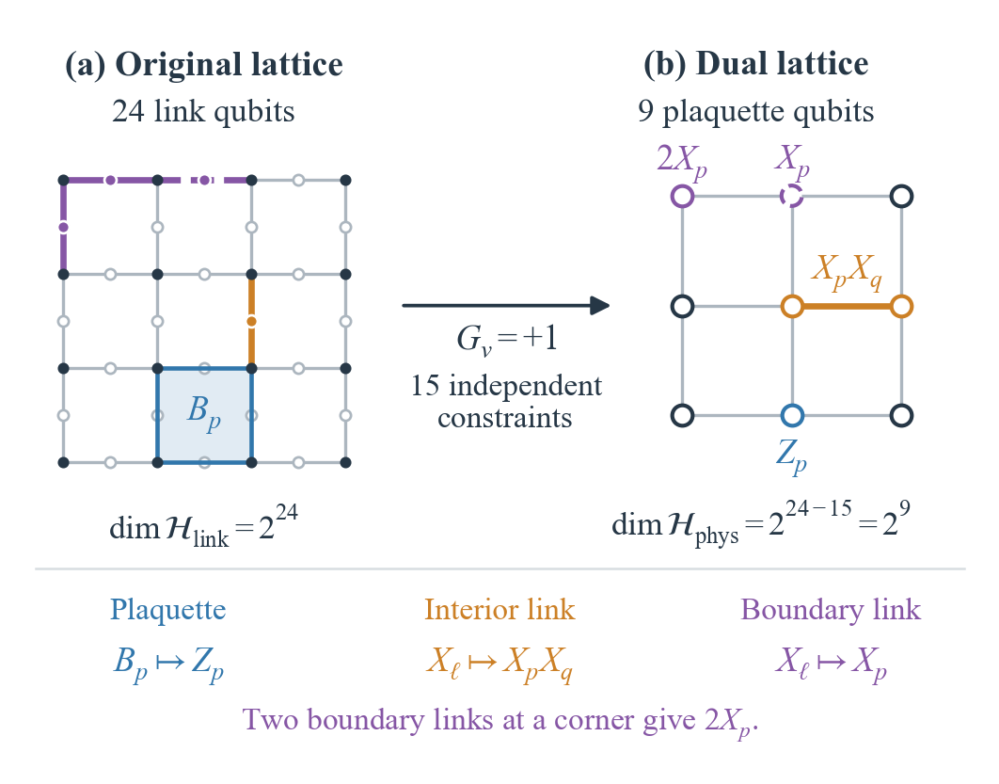

# Z2 gauge-theory benchmark

Source run: `20260920T073518Z_799c77bd`. Selected from the final revised manuscript figure sources.

- [Final report (PDF)](reports/Final_Academic_Report_20260920T073518Z_799c77bd.pdf)
- [Final report (Markdown)](reports/Final_Academic_Report_20260920T073518Z_799c77bd.md)
- [Original report result images](reports/figures/)
- [Final manuscript figures and data](figures/paper/)

The manuscript presents the numerical results as a table, rather than a result plot. [CSV data](figures/paper/z2_results.csv) preserve its displayed precision.

| Method | aE vacuum | aE excited | aDeltaE |
|---|---:|---:|---:|
| ED | -25.122839 | -17.567359 | 7.555480 |
| TN | -25.122839 | -17.567359 | 7.555480 |
| Qiskit D=1 | -25.110287 | -17.360130 | 7.750157 |
| Qiskit D=2 | -25.122776 | -17.425902 | 7.696873 |
| Qiskit D=4 | -25.122828 | -17.516658 | 7.606171 |
| Qiskit D=8 | -25.122834 | -17.565535 | 7.557299 |
| IBM D=1 | — | — | 8.1483 ± 0.1350 |

The stored cross-check verdict is `not_approved`; images and hardware results do not override it. Generated programs and numerical results retain the original run versions. `config.json` starts a new workflow with current prompts and hardware disabled.
