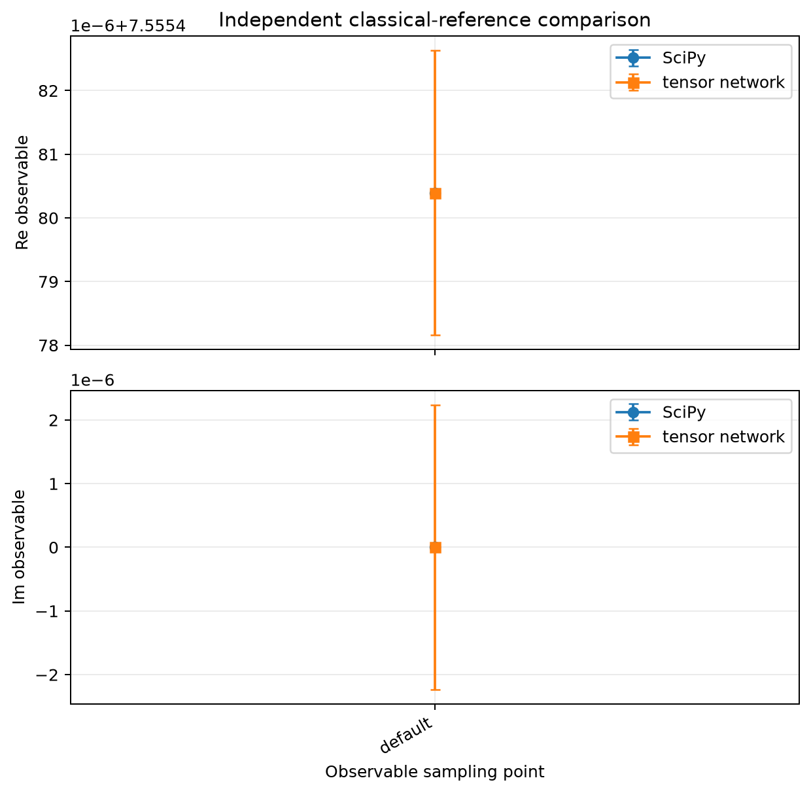
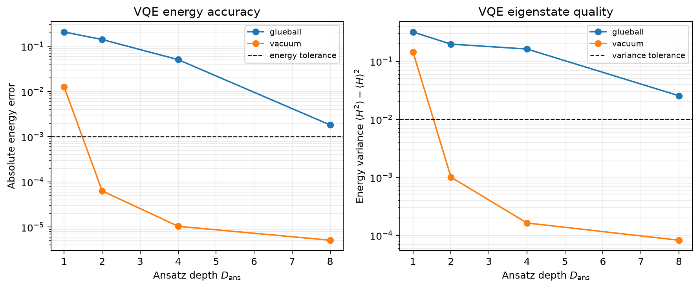
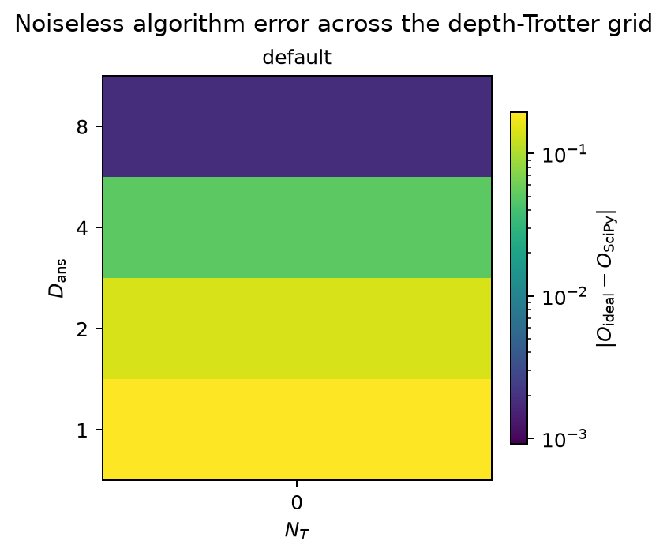
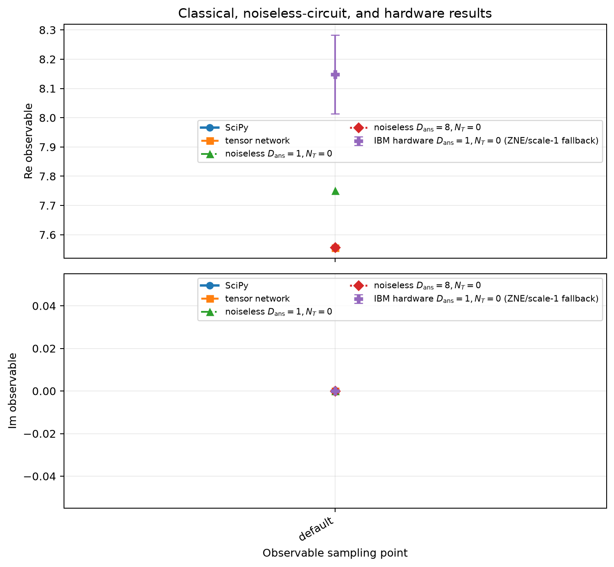

# Finite-Lattice Glueball–Vacuum Energy Difference in \(2+1\)-Dimensional Pure \(\mathbb Z_2\) Gauge Theory: Noiseless Validation and a Shallow IBM Demonstration

## Abstract

We study the difference between the first excited-state and vacuum expectation values of the Hamiltonian in \(2+1\)-dimensional pure \(\mathbb Z_2\) lattice gauge theory. The theory is intrinsically defined by a spatial-lattice Kogut–Susskind Hamiltonian; no unique local continuum Lagrangian is inferred. A \(4\times4\) open square lattice at bare coupling \(g=1\) is reduced exactly to the charge-free sector \(G_v=+1\) by a plaquette-dual transformation, yielding nine qubits and no gauge-field truncation. Independent Hamiltonian-variational circuits prepare the vacuum and the zero-based level-1 state, and the requested energy difference is reconstructed from 58 direct Pauli-expectation measurements. SciPy exact diagonalization gives \(a\Delta E=7.555480393464407\), while an ITensor matrix-product-state calculation gives \(a\Delta E=7.555480393464165\); their difference, \(2.42\times10^{-13}\), passes the \(10^{-4}\) classical cross-check tolerance. Noiseless circuit values improve from \(7.7501566\) at ansatz depth \(D_{\rm ans}=1\) to \(7.5572991\) at \(D_{\rm ans}=8\). Nevertheless, the deepest error, \(1.82\times10^{-3}\), exceeds the prescribed \(10^{-3}\) algorithm tolerance, and the depth-scan tail is not stable. Thus algorithmic convergence and excited-state preparation are not validated. A deliberately minimal \(D_{\rm ans}=1\) circuit was executed on `ibm_kawasaki`, producing \(a\Delta E=8.1483\pm0.1350\). Its appropriate benchmark is the identical noiseless shallow circuit, \(7.7502\), rather than the converged classical answer. The hardware result used measurement mitigation and a mixture of zero-noise extrapolation and scale-1 fallbacks where extrapolated uncertainties failed the stability rule. This execution demonstrates a shallow finite-lattice measurement workflow, but not deep-circuit convergence or continuum-limit accuracy.

## 1. Physical problem and Hamiltonian formulation

### 1.1 Theory and conventions

The model is pure \(\mathbb Z_2\) gauge theory in \(2+1\) dimensions in Kogut–Susskind Hamiltonian form. It is intrinsically a spatial-lattice theory with continuous Hamiltonian time. Consequently, the term “continuum formulation” here denotes the underlying Hamiltonian specification and conventions before selecting the finite \(4\times4\) realization; the evidence does not determine a unique local continuum Lagrangian.

The unshifted Hamiltonian is

$$
H=-\frac{1}{a}\left(g^2\sum_{\ell}X_\ell+g^{-2}\sum_p B_p\right),
\qquad
B_p=\prod_{\ell\in\partial p}Z_\ell ,
$$

where \(a>0\) is the spatial lattice spacing, \(g>0\) is the bare coupling, \(\ell\) labels spatial links, \(p\) labels plaquettes, and \(X_\ell,Z_\ell\) are Pauli operators on a \(\mathbb Z_2\) link. They obey

$$
X_\ell^2=Z_\ell^2=\mathbf 1,\qquad
X_\ell Z_\ell=-Z_\ell X_\ell ,
$$

while operators on distinct links commute. At \(g=1\),

$$
H=-\frac{1}{a}\left(\sum_\ell X_\ell+\sum_pB_p\right).
$$

Natural units with \(c=1\) are used. Time is continuous; if a temporal discretization were introduced, the supplied convention would set \(a_t=a\). The metric convention is \(\eta_{\mu\nu}=\operatorname{diag}(+1,-1,-1)\), although no fermionic or gamma-matrix structure enters the pure-gauge calculation. No gauge fixing and no vacuum-energy shift are applied. Numerical results below are reported as the dimensionless quantity \(a\Delta E\), corresponding to the implementation convention \(a=1\).

Local gauge transformations are generated at each vertex \(v\) by

$$
G_v=\prod_{\ell\ni v}X_\ell .
$$

The Hamiltonian is gauge invariant because \([H,G_v]=0\). “Gauss’s law zero” means zero gauge charge, hence the physical eigenvalue is \(G_v=+1\), not \(G_v=0\).

### 1.2 External states and requested observable

The two external states are:

- \(\lvert\mathrm{vacuum}\rangle\): the ground state of the unshifted Hamiltonian in the charge-free physical sector;
- \(\lvert\mathrm{glueball}\rangle\): the zero-based level-1 distinct-energy eigenstate in the same sector, without imposing an additional \(D_4\), time-reversal, translation, or one-form symmetry label.

The complete requested matrix-element combination is

$$
\mathcal O
=
(+1)\langle\mathrm{glueball}|H|\mathrm{glueball}\rangle
+
(-1)\langle\mathrm{vacuum}|H|\mathrm{vacuum}\rangle .
$$

Equivalently,

$$
\mathcal O
=
\langle\mathrm{glueball}|H|\mathrm{glueball}\rangle
-
\langle\mathrm{vacuum}|H|\mathrm{vacuum}\rangle
\equiv \Delta E .
$$

The vacuum subtraction belongs only to this observable combination; it is not inserted as a shift in \(H\). Because both terms are diagonal matrix elements of a Hermitian operator,

$$
\operatorname{Im}\mathcal O=0
$$

exactly. Individual glueball or vacuum energies are components of the requested quantity and must not be interpreted separately as the requested observable.

## 2. Lattice discretization and boundary conditions

### 2.1 Finite open lattice

The realization uses a \(4\times4\) square array of vertices \((x,y)\), with \(x,y\in\{0,1,2,3\}\), and open boundary conditions in both spatial directions. There are:

- 16 vertices;
- 24 links, comprising horizontal links \(h_{x,y}\) with \(x=0,1,2\), \(y=0,1,2,3\), and vertical links \(v_{x,y}\) with \(x=0,1,2,3\), \(y=0,1,2\);
- nine plaquettes \(p_{x,y}\), with \(x,y=0,1,2\).

The \(4\times4\) size is a finite-lattice realization parameter, not a continuum coupling. Open boundaries preserve the square dihedral symmetry \(D_4\), but break nontrivial lattice translations. They also admit no noncontractible electric one-form generator.

There are no matter fields or fermions. Therefore no staggered, Wilson, overlap, or other fermion discretization is performed. All discretized degrees of freedom are \(\mathbb Z_2\) gauge variables.

### 2.2 Exact Gauss-law elimination

For each plaquette \(p\), introduce a dual Pauli degree of freedom \(\tau_p\). If \(A(\ell)\) denotes the set of plaquettes incident on link \(\ell\), then

$$
A(h_{x,y})
=
\{p_{x,y}:y\leq2\}
\cup
\{p_{x,y-1}:y\geq1\},
$$

and

$$
A(v_{x,y})
=
\{p_{x,y}:x\leq2\}
\cup
\{p_{x-1,y}:x\geq1\}.
$$

The exact open-boundary dual map is

$$
B_p\mapsto\tau_p^z,
\qquad
X_\ell\mapsto\prod_{p\in A(\ell)}\tau_p^x.
$$

Under this map every Gauss operator becomes the identity on the reduced physical Hilbert space:

$$
G_{x,y}=\prod_{\ell\ni(x,y)}X_\ell,
\qquad
G_{x,y}\big|_{\mathcal H_{\rm phys}}=\mathbf 1.
$$

The finite-lattice Hamiltonian is consequently

$$
H_{\rm lat}
=
-\frac1a
\left[
g^2\sum_{x=0}^{2}\sum_{y=0}^{3}
\prod_{p\in A(h_{x,y})}\tau_p^x
+
g^2\sum_{x=0}^{3}\sum_{y=0}^{2}
\prod_{p\in A(v_{x,y})}\tau_p^x
+
g^{-2}\sum_{x=0}^{2}\sum_{y=0}^{2}\tau_{x,y}^z
\right].
$$

The lattice observable is \(O_{\rm lat}=H_{\rm lat}\), and the requested finite-lattice combination is

$$
\mathcal O_{\rm lat}
=
\langle\mathrm{glueball}|H_{\rm lat}|\mathrm{glueball}\rangle
-
\langle\mathrm{vacuum}|H_{\rm lat}|\mathrm{vacuum}\rangle .
$$

This is not a gauge-field truncation. A \(\mathbb Z_2\) link is already two-dimensional, and the dual reduction is exactly equivalent to the complete charge-free sector on a connected, simply connected open lattice. The original link Hilbert space has dimension \(2^{24}=16\,777\,216\). Fifteen independent Gauss constraints reduce it to the physical dimension \(2^9=512\), represented exactly by nine plaquette qubits.

## 3. Qubit mapping and physical-sector restrictions

The nine qubits are ordered as

$$
(q_0,\ldots,q_8)
=
\bigl(
p(0,0),p(1,0),p(2,0),
p(0,1),p(1,1),p(2,1),
p(0,2),p(1,2),p(2,2)
\bigr),
$$

with Qiskit little-endian Pauli labels. Each \(B_p\) maps to a single-qubit \(Z\), while each electric link term maps to either a one-qubit boundary \(X\) or a nearest-neighbour \(XX\) operator. At \(g=a=1\), the mapped Hamiltonian contains exactly 24 electric terms and nine magnetic \(Z\) terms, each inherited with coefficient \(-1\) before combining duplicate boundary strings. The maximum reduced Pauli support is two.

The complete nine-qubit computational basis,

$$
\left\{
|b_8b_7\cdots b_0\rangle:
b_j\in\{0,1\}
\right\},
$$

is already the physical \(G_v=+1\) Hilbert space. No post-selection, penalty term, or computational-basis filtering is needed. The mapped operator algebra was checked: all electric operators commute with one another, all plaquette operators commute with one another, and a mapped \(B_p\) anticommutes with \(X_\ell\) exactly when \(p\) is incident on \(\ell\).

The vacuum is selected from the lowest eigenspace of this unshifted nine-qubit Hamiltonian. The glueball is selected from the next distinct energy level in the same complete physical space. No extra discrete-symmetry eigenvalue is imposed.

## 4. Quantum algorithm

### 4.1 Variational state preparation

The vacuum reference state is

$$
|+\rangle^{\otimes9},
$$

prepared by applying a Hadamard gate to every qubit. The glueball reference is orthogonal to it: the central plaquette \(q_4\) is prepared in \(|-\rangle\), while all other qubits are prepared in \(|+\rangle\).

Each state then receives an independent Hamiltonian-variational ansatz. No variational parameter is shared between the vacuum and glueball circuits. One complete layer contains:

- nine \(R_Z\) rotations;
- eight \(R_X\) rotations on the noncentral boundary sites;
- 12 nearest-neighbour \(R_{XX}\) rotations.

With \(R_{XX}(\phi)\) decomposed into two controlled-NOT gates and one \(R_Z\), one layer contains 24 controlled-NOT gates and 77 one-qubit gates before cancellation. It has 29 independent parameters. The implemented angles preserve the aggregated Hamiltonian coefficients: \(-2\alpha_Z\) for every \(Z\) generator, \(-4\alpha_X\) for corner \(X\) generators, \(-2\alpha_X\) for noncorner boundary \(X\) generators, and \(-2\alpha_{XX}\) for each nearest-neighbour \(XX\) generator.

The ansatz is nested by depth. A circuit at depth \(D_{\rm ans}+1\) is obtained by appending one complete layer with 29 fresh parameters to the depth-\(D_{\rm ans}\) circuit. The tested schedule was

$$
D_{\rm ans}\in\{1,2,4,8\}.
$$

The deeper optimizations were warm-started from shallower parameters. The runtime used at most 200 optimizer iterations, two restarts, a parameter perturbation scale of \(0.01\), and random seed 12345. The vacuum objective was the energy. The glueball used a sequential lower-level orthogonality procedure with a variational-deflation penalty; at the selected depth \(D_{\rm ans}=8\), the penalty strength was 72.6.

Although every circuit remains exactly in the Gauss-law sector, gauge-sector preservation alone does not establish preparation of the requested energy eigenstate. Energy errors, variances, and orthogonality diagnostics were therefore retained as separate state-quality tests.

### 4.2 Time evolution and Trotterization

No real- or imaginary-time evolution is required. The Hamiltonian is measured directly at equal time on the prepared states. Accordingly,

$$
N_T=0
$$

is a runtime sentinel meaning “not applicable,” not a zero-step approximation to an otherwise required evolution. No Trotter product formula is constructed, and no Trotter-convergence claim can be made or is needed for this observable.

### 4.3 Measurement and reconstruction

For each state, 20 distinct electric Pauli strings and nine single-qubit magnetic \(Z\) strings are measured, giving 29 recipes per state and 58 recipes in total. No ancilla qubit is used. The direct energy-estimation principle is a weighted sum of Pauli expectations [4].

Let \(e_s(P)\) denote the measured expectation of Pauli string \(P\) in state \(s\in\{\mathrm{glueball},\mathrm{vacuum}\}\). Reconstruction applies the Hamiltonian coefficient to every electric and magnetic term and then forms the state difference:

$$
\operatorname{Re}\mathcal O_{\rm lat}
=
-\frac{g^2}{a}
\sum_{\ell}
e_{\mathrm{glueball}}
\left(
\prod_{p\in A(\ell)}\tau_p^x
\right)
-\frac{g^{-2}}{a}
\sum_p e_{\mathrm{glueball}}(\tau_p^z)
$$

$$
\hspace{1.5cm}
+\frac{g^2}{a}
\sum_{\ell}
e_{\mathrm{vacuum}}
\left(
\prod_{p\in A(\ell)}\tau_p^x
\right)
+\frac{g^{-2}}{a}
\sum_p e_{\mathrm{vacuum}}(\tau_p^z).
$$

Repeated mapped Pauli strings retain their link multiplicity; in particular, the relevant corner boundary-\(X\) strings carry multiplicity two. No identity shift or state-dependent Hamiltonian coefficient is added. The reconstructed imaginary component is set to zero exactly.

## 5. Numerical results

### 5.1 Branch A: noiseless algorithm validation

#### Classical references

SciPy exact diagonalization and an ITensor matrix-product-state calculation independently evaluated the same finite-lattice, nine-qubit physical-sector problem.

| Method | \(aE_{\rm vacuum}\) | \(aE_{\rm glueball}\) | \(a\Delta E\) |
|:--|--:|--:|--:|
| SciPy exact diagonalization | \(-25.1228389191042\) | \(-17.5673585256398\) | \(7.55548039346441\) |
| ITensor MPS/DMRG | \(-25.1228389191040\) | \(-17.5673585256398\) | \(7.55548039346417\) |

The SciPy residual norms were \(2.57\times10^{-14}\) for the vacuum and \(2.13\times10^{-14}\) for the glueball, below the \(2.51\times10^{-9}\) residual tolerance. The ITensor scan increased the maximum bond dimension from 8 to 32 and tightened the truncation cutoff from \(10^{-10}\) to \(10^{-14}\). Its final vacuum variance was \(5.00\times10^{-12}\), while the reported glueball variance was zero at displayed precision.

The classical observable difference was \(2.42\times10^{-13}\), the energy difference between solver records was \(2.34\times10^{-13}\), and the combined observable uncertainty was \(3.16\times10^{-6}\). Both solvers converged, and their discrepancy was below the \(10^{-4}\) classical tolerance.

#### VQE state quality

At the shallowest depth, both prepared states were classified as best-effort:

| State, \(D_{\rm ans}=1\) | Energy | Energy error | Variance |
|:--|--:|--:|--:|
| Glueball | \(-17.36013\) | \(0.20723\) | \(0.31980\) |
| Vacuum | \(-25.11029\) | \(0.01255\) | \(0.14526\) |

At \(D_{\rm ans}=8\), the vacuum reached energy \(-25.12283378\), with energy error \(5.14\times10^{-6}\) and variance \(8.26\times10^{-5}\), and was classified as a converged state. The glueball reached \(-17.56553464\), with energy error \(1.82\times10^{-3}\), variance \(2.55\times10^{-2}\), and orthogonality overlap \(2.59\times10^{-10}\); it remained a best-effort state. Both sector weights were unity to numerical precision, confirming physical-sector preservation but not energy-eigenstate convergence.

#### Observable-depth scan

The noiseless reconstructed observable was scanned over the complete prescribed depth schedule:

| \(D_{\rm ans}\) | \(N_T\) | Noiseless \(a\Delta E\) | Error versus SciPy | Within \(10^{-3}\)? |
|--:|--:|--:|--:|:--:|
| 1 | 0, not applicable | 7.750157 | 0.194676 | No |
| 2 | 0, not applicable | 7.696873 | 0.141393 | No |
| 4 | 0, not applicable | 7.606171 | 0.050690 | No |
| 8 | 0, not applicable | 7.557299 | 0.001819 | No |

The error decreases substantially with increasing depth, so the scan exhibits clear improvement toward both classical references. This is observed finite-depth improvement, not an extrapolation to infinite depth. The adjacent observable changes were \(0.05328\), \(0.09070\), and \(0.04887\). The final change is much larger than the \(10^{-3}\) tail-stability tolerance, so the depth-convergence check failed. The deepest error, \(1.82\times10^{-3}\), also exceeds the \(10^{-3}\) algorithm tolerance.

Because only the sentinel \(N_T=0\) appears, Trotter convergence is not applicable. The absence of multiple \(N_T\) points is not a failed Trotter test.

The noiseless branch therefore validates the implementation trend and its approach toward mutually consistent classical references, but it does **not** validate algorithmic convergence, the prescribed endpoint tolerance, or the glueball state preparation. The overall cross-check status was consequently not approved, and no candidate was classified as algorithmically hardware-eligible.

### 5.2 Branch B: minimal-hardware demonstration point

The hardware branch deliberately used the shallowest circuit,

$$
D_{\rm ans}=1,\qquad N_T=0\ \text{(not applicable)}.
$$

This point was not chosen because it approximates the classical answer accurately. Its noiseless algorithm error relative to SciPy is \(0.19468\), and both shallow states are best-effort states. The candidate is therefore scientifically interpreted only through a comparison between the hardware execution and the identical noiseless \(D_{\rm ans}=1\) circuit.

| Quantity | \(a\Delta E\) |
|:--|--:|
| SciPy reference | 7.555480 |
| ITensor reference | 7.555480 |
| Identical noiseless \(D_{\rm ans}=1\) circuit | 7.750157 |
| IBM hardware, \(D_{\rm ans}=1\) | \(8.1483\pm0.1350\) |

The classical values are included to show the full finite-lattice context, but they are not acceptance targets for the shallow hardware execution. Likewise, the \(D_{\rm ans}=8\) noiseless result is part of the separate convergence study and was not run on hardware.

## 6. Quantum-hardware execution

The shallow circuit was retrieved from an execution on the 156-qubit `ibm_kawasaki` backend. For the 58 logical measurement recipes, the untranspiled circuits used nine qubits, logical depth 43, and 24 two-qubit gates per recipe. After transpilation, glueball recipes had depth 69 and 30 two-qubit gates, whereas vacuum recipes had depth 37 and 11 two-qubit gates. No SWAP gates were inserted. Across all recipes there were 1,189 two-qubit gates. The maximum additive two-qubit error sum for an individual recipe was \(0.02816\), below the configured limit of 1.0; this sum is a noise proxy, not a failure probability.

The reconstructed hardware result was

$$
a\Delta E_{\rm hw}=8.1482613\pm0.1350252,
$$

where the quoted uncertainty is the propagated statistical standard error. The identical noiseless shallow circuit gave

$$
a\Delta E_{\rm ideal}^{(D_{\rm ans}=1)}=7.7501566.
$$

Their recorded difference is \(0.39810\). This difference assesses the combined effect of hardware noise, sampling, compilation, and mitigation on the shallow workflow. It does not assess the ansatz’s convergence toward the finite-lattice eigenvalue, because that algorithmic error is already appreciable at \(D_{\rm ans}=1\).

The execution used resilience level 2, measurement mitigation, and nominal zero-noise extrapolation (ZNE) with noise factors \(1\), \(3\), and \(5\). Exponential and linear extrapolators were available. However, mitigation was not uniformly successful across all component expectations. Of the 58 recipes, 43 used a ZNE-extrapolated value, while 15 used a `noise_factor_1_fallback_unstable_zne` result. These 15 values are scale-1 fallbacks, not ZNE estimates: their extrapolated uncertainty failed the stability rule, so the measured noise-factor-1 value was retained. The final observable therefore combines genuinely extrapolated components with fallback components. Its error bar should not be interpreted as evidence that all systematic mitigation uncertainty has been removed.

This hardware comparison validates only that the prescribed shallow preparation, Pauli measurement, mitigation/fallback logic, and observable reconstruction were executed and can be compared with their identical noiseless circuit. It does not establish agreement with SciPy or ITensor, does not imply that \(D_{\rm ans}=2,4,\) or \(8\) ran on hardware, and provides no evidence about a continuum limit.

## 7. Limitations

Several limitations constrain the interpretation.

1. **No continuum extrapolation was performed.** Only one \(4\times4\) open lattice, one bare coupling \(g=1\), and one spacing convention \(a=1\) were studied. The results are finite-lattice quantities and cannot establish continuum-limit accuracy.

2. **Boundary dependence was not scanned.** Open boundaries were required by the selected exact nine-qubit dual reduction. Periodic boundaries would contain independent noncontractible sectors and would not be represented by the same one-qubit-per-plaquette construction without additional degrees of freedom.

3. **Depth convergence failed.** Although the noiseless observable moved close to the classical result, the final adjacent depth change was \(0.04887\), well above the \(10^{-3}\) tail criterion. The \(D_{\rm ans}=8\) error also remained above the \(10^{-3}\) endpoint tolerance.

4. **The excited state remained imperfect.** At \(D_{\rm ans}=8\), the glueball variance was \(0.0255\) and its energy error was \(0.00182\). State preparation was not validated at any scanned depth, even though the vacuum was individually well converged at larger depths.

5. **Optimization was resource-limited.** Several optimizations terminated at the maximum iteration count. The residual continued to improve at the largest tested depth, so deeper warm-started circuits may be informative, but no numerical extrapolation beyond \(D_{\rm ans}=8\) is supported.

6. **No Trotter study applies.** The observable required no time evolution. The recorded \(N_T=0\) is a sentinel and supplies no information about product-formula errors in a dynamical calculation.

7. **Hardware mitigation was heterogeneous.** Fifteen component observables fell back to scale-1 values because their ZNE uncertainties failed the stability rule. Residual readout, gate, decoherence, calibration-drift, sampling, and extrapolation systematics may remain.

8. **The hardware point was intentionally algorithmically inaccurate.** Its purpose was a minimal execution demonstration. Requiring it to agree with the converged classical result would conflate hardware error with the known shallow-ansatz error.

## 8. Conclusion

An exact open-boundary Gauss-law reduction transformed the \(4\times4\) pure \(\mathbb Z_2\) gauge theory from 24 link qubits to the complete 512-dimensional physical space of nine plaquette qubits, without gauge fixing or truncation. SciPy and ITensor independently agreed on the requested glueball–vacuum Hamiltonian difference,

$$
a\Delta E=7.555480393464\ldots,
$$

to approximately \(2.4\times10^{-13}\), thereby validating the finite-lattice classical reference.

The noiseless quantum algorithm showed substantial depth improvement, reaching \(a\Delta E=7.5572991\) at \(D_{\rm ans}=8\). Nevertheless, neither the endpoint tolerance nor tail-stability criterion was satisfied, and the glueball remained a best-effort state. The noiseless study therefore supports implementation consistency and a promising convergence trend, but not validated algorithmic convergence.

The separate IBM demonstration executed only the minimal \(D_{\rm ans}=1\) circuit and obtained \(a\Delta E=8.1483\pm0.1350\), compared with \(7.7502\) for the identical noiseless circuit. This comparison tests shallow-circuit hardware realization and reconstruction, including mixed ZNE and scale-1 fallback mitigation. It does not validate the deeper ansatz, the classical finite-lattice answer, or any continuum limit.

## 9. References and evidence provenance

The supplied evidence identifies the following literature artifacts; author and title metadata were not provided and are therefore not inferred.

1. `arXiv:2008.02941v2`, Eq. (hva): Hamiltonian variational ansatz definition. The present work uses a modified form adapted to the open-boundary dual \(\mathbb Z_2\) Hamiltonian, with independent parameters for each distinct generator.

2. `arXiv:2308.04481v3`, Section II, steps 1–6: SC-ADAPT-VQE. This adaptive construction was considered incompatible with the required predetermined scalable gate sequence and was not selected.

3. `arXiv:1904.10910v3`, discussion preceding the reported ansatz comparisons: generic hardware-efficient ansatz alternatives. Such an ansatz was not selected because it does not encode the supplied interaction graph or offer a model-specific physical-sector advantage.

4. `arXiv:1704.05018v2`, Eq. (Hq) and the preceding discussion of angle updates: estimation of energy as a weighted sum of Pauli expectations. This directly supports the measurement and reconstruction protocol.

The numerical provenance consists of a SciPy exact-diagonalization reference, an ITensor MPS/DMRG reference, a noiseless depth scan over \(D_{\rm ans}=1,2,4,8\), and one retrieved `ibm_kawasaki` execution at \(D_{\rm ans}=1\). The classical and noiseless convergence checks, hardware feasibility assessment, and retrieved hardware record belong to the same documented campaign and parameter contract.
